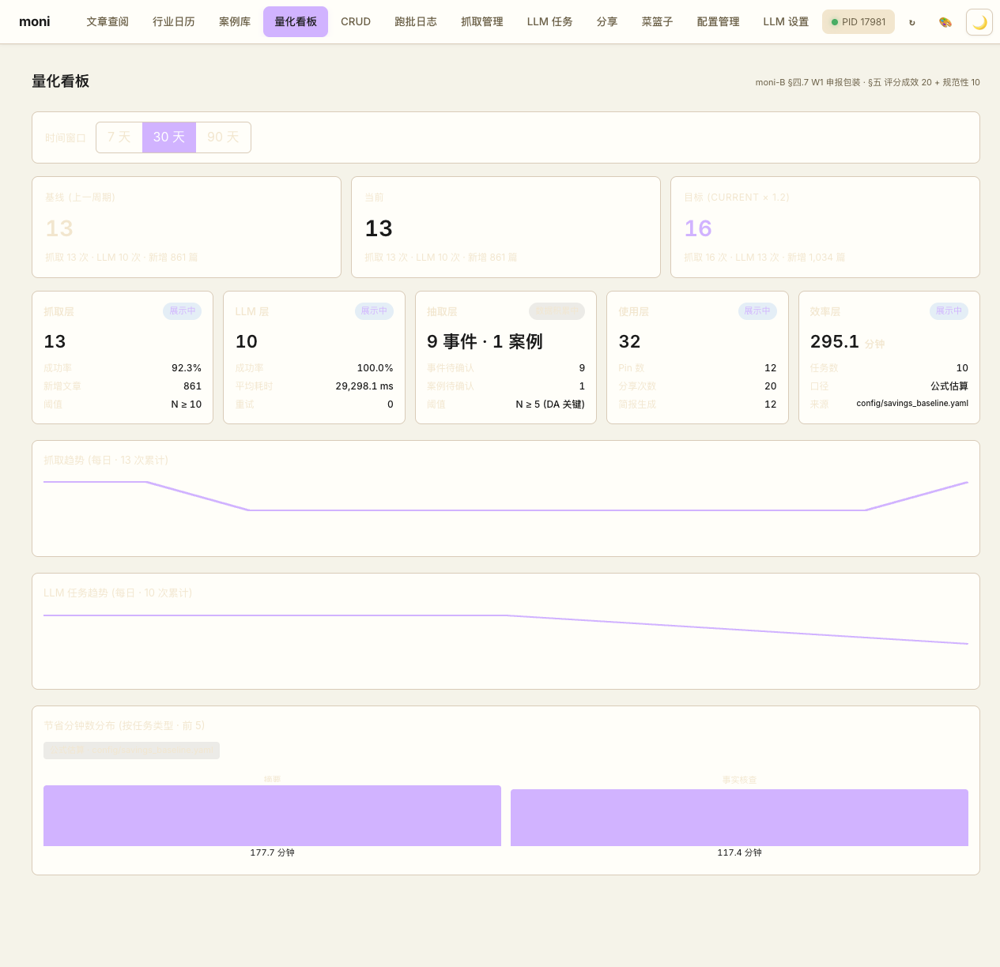

# moni 操作手册（零基础版）

> 面向银行产品经理 / 客户经理 / 研究员 / 营销人员等**零 IT 基础**岗位。
> 目标：**5 分钟上手，从"打开"到"出简报"全流程**。
> 本文档不需要任何 Python / 命令行 / API 知识。版本: v1.0.20 (2026-08-10)。

---

## 快速路线图（全程 5 步，约 5 分钟）

```
1. 打开 moni      → 浏览器输入 127.0.0.1:8900
2. 看今日要闻      → 文章列表已按"业务价值评分"从高到低排好
3. 选中好文章      → 点"Pin"收藏
4. 一键出简报      → 点"用当前 Pin 生成简报" → 选格式 → 等 30 秒
5. 拿走产物        → PDF / HTML / 图片 已生成，直接用
```

**第 1 次用只需要会两件事：打开浏览器 + 点鼠标。**

---

## 第 1 步：打开 moni

1. 打开浏览器（Chrome / Safari 都可以）
2. 地址栏输入：`127.0.0.1:8900`，按回车
3. 看到蓝色导航栏 + 文章列表 = 成功

> 顶栏菜单就是整个系统的入口。常用的 3 个：
> - **文章查阅** — 看所有抓回来的同业资讯（默认打开）
> - **行业日历** — 按日期看行业事件（监管/产品/融资/技术）
> - **量化看板** — 看系统帮你省了多少时间

---

## 第 2 步：看今日要闻（不用自己挑）

moni 已经帮你把每篇文章排好队了：

1. 打开"文章查阅"
2. 列表**默认按业务价值评分从高到低排**（评分 = AI 判断这篇对你多有用）
3. 高分文章（90+）优先读，低分的扫一眼标题即可
4. 每篇还带 **【已核实 / 待核实 / 存疑】** 标签 — 信不信一目了然

**省事原理**：以前是你自己逐篇打开 5-8 个网站筛选；现在 moni 替你筛好排好，你只读"今日最值得读"。

---

## 第 3 步：收藏好文章（Pin）

看到值得留档的文章：

1. 在该行点 **"Pin 这篇文章"** 按钮
2. 按钮变成 **"取消 Pin"** = 已收藏
3. 顶栏 **Pin (数字)** 显示已收藏数量

可以 Pin 任意多篇，Pin 住的文章会进入你的"待研究清单"。

---

## 第 4 步：一键生成简报（核心功能）

收藏了几篇相关的文章后（比如 3 篇关于"稳定币"的）：

1. 点顶栏 **Pin (数字)** → 进入收藏列表
2. 勾选要出简报的文章（点文章前面的方框）
3. 点 **"用当前 Pin 生成简报"** 按钮
4. 选格式：
   - **PDF** — 打印 / 邮件附件
   - **HTML 网页** — 浏览器直接看
   - **PNG 图片** — 发微信 / 朋友圈
   - Markdown / 纯文本 — 复制进笔记
5. 点生成，**等 30 秒左右**，产物自动出现在"分享"页



---

## 第 5 步：拿走简报产物

1. 打开顶栏 **"分享"**
2. 看到任务列表，**状态 = 完成** 的行
3. 点对应产物文件 → 下载 / 打开
4. 简报自带：文章摘要 + 事实核查标签 + 原文链接，**可以直接发**

---

## 进阶用法（可选，用熟了再看）

### 看行业事件日历（"近期发生了什么"全景）

顶栏 **行业日历** → 月历视图：

- 有事件的日期有**彩色圆点**（橙=融资 / 蓝=产品 / 绿=技术 / 红=监管）
- 点某天格子 → 弹出当天事件详情 → 点"查看原文"看文章
- 右侧"待确认事件"列表：AI 抽的事件日期不确定时会列在这，你可以点 **确认 / 驳回** 帮 AI 纠错

### 查同业案例库（"哪家银行做了什么"）

顶栏 **案例库** → 可搜索：

- 输入 ≥3 个字（如"招商银行"）→ 搜到相关同业案例
- 每个案例有唯一编号（如 `MN-AI-2608-0042`），写报告可直接引用

### 看量化看板（"系统帮我省了多少时间"）

顶栏 **量化看板** → 三张卡片 + 5 个模块：

- **基线 / 当前 / 目标** — 你的信息处理效率变化
- **节省分钟数** — 系统估算帮你节省的时间（公式标注清晰，不夸大）

---

## 常见问题

**Q: 打开 127.0.0.1:8900 显示打不开？**
A: moni 服务没启动。启动方式见 `USER_GUIDE.md` 第 1 节（或让 IT 帮你跑一条命令）。

**Q: 文章列表是空的？**
A: 需要先同步。点顶栏 **⚡ 全部同步** 按钮，等 5-10 分钟自动入库。

**Q: 简报生成要等多久？**
A: 3 篇约 30 秒；篇数越多越久。队列在"分享"页能看到进度条。

**Q: 怎么关掉 moni？**
A: 关浏览器窗口即可，moni 服务在后台继续跑（每天定时同步 4 次）。

---

## 安全与合规（放心用）

- moni **不持有任何 API key**，AI 调用走本地通道，模型权责分离
- **不处理敏感客户信息**，只抓公开互联网资讯
- 数据**不出本地网络**（127.0.0.1 单端口）
- 所有 AI 输出带**事实核查标签**，你复核后采纳，留痕可追溯

---

*文档: W5 图文版操作手册 (2026-08-10)。详细技术参考见 `USER_GUIDE.md`。*
