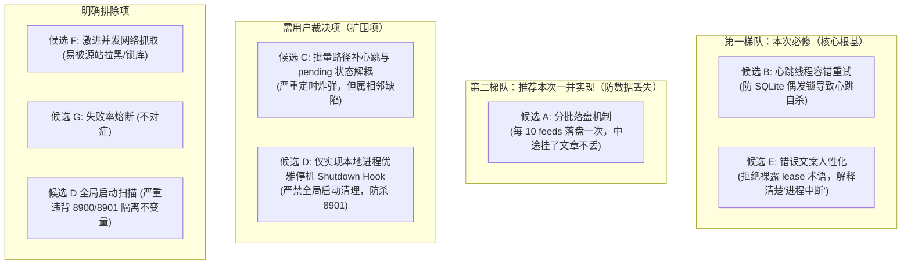

# BestBlogs 抓取中断修复方案 Reference（候选评估与实施路线）

> 文档创建日期：2026-11-05  
> 文档性质：架构与修复方案决策参考（Reference Plan），不包含任何代码修改。  
> 目标：基于已核实的 L1~L3 根因链，逐项评估候选修复方案 A~G，给出清晰的优先级排序、本次落地推荐组合与需用户裁决清单。

---

## 1. 对既有结论的复核与确认

对 Task Brief 中列出的 L1~L3 事实与代码逻辑进行了全面对账，结论如下：
- **L1（进程被杀与更替）完全确证**：
  - `fetch_jobs` 表中 `id = '00651ad1'` 的字段、运行耗时（284s）、进度（95 feeds / 475 articles）、状态（`stale`）及错误原因与 SQLite 数据库只读查询完全吻合。
  - macOS 统一日志与 `lsof` 证实原进程 PID 16247 于 15:59:22 退出，新进程 PID 83307 立即被 launchd 拉起，最后进度保存（15:59:19）与进程死亡仅相差 3 秒，工作线程死前无任何异常退出迹象。
- **L2（各环节机制缺陷）完全确证**：
  - `moni/fetch/sources/bestblogs.py:163-221` 确实将文章全量滞留于内存 `all_articles`，未落盘导致崩溃时 475 篇文章全部灭失。
  - `moni/web/routes/fetch.py:352-369` 的心跳循环确实存在单次异常直接 `return` 永久退出的逻辑脆弱点。
  - `moni/web/routes/fetch.py:787-865` 的批量路径确实只创建 job，完全无租约认领与心跳续约，且排队任务预置为 `running`，超过 90s 必被误杀。
  - `moni/db/leases.py:231` 写死底层租约错误词条，前端 `moni/web/static/js/app.js:1825` 原样透传，导致用户误判为抓取超时。
- **L3（已排除项）完全确证**：
  - `moni/web/routes/config_sources.py:45` 中 BestBlogs 的 `timeout_sec` 为 1800 秒，远大于 284 秒，业务超时未触发。
  - 95 个 feed 产出 475 篇（单 feed 上限 5 篇），说明绝大部分 feed 完全成功，SSL EOF 仅为局部网络波动并已被重试机制吸收。
- **结论**：既有 L1~L3 结论 100% 成立，无任何需更正的事实偏差。

---

## 2. 候选修复项逐项评估（A ~ G）

### 候选 A：分批落盘（Chunked Ingestion）
- **涉及代码与路径**：
  - `moni/fetch/sources/bestblogs.py:168-200`（抓取循环）
  - `moni/fetch/base.py:143-270`（`BaseFetcher.run()` 管道）
  - `moni/db/repository.py:22-135`（`ArticleRepository.dedupe_insert()`）
- **改动思路**：
  每抓取满 N 个 feed（如每 10 个 feed）或累计达到 M 篇未入库文章时，触发一次中间落盘（调用管道的过滤与 `dedupe_insert()`），将已抓取文章即时提交入库，并更新进度统计。
- **合规与架构核对（重要）**：
  根据 `AGENTS.md` 核心不变量 1，落盘必须严格通过 `moni/fetch/keyword_match.py`、`filters.py` 与 `tag_filter.py` 闸门，且 `dedupe_insert` 需正确写入 `article_tags` 与 `article_keyword_hits`。因此不能在 `bestblogs.py` 内部粗暴直接调 repo 写入，而应由 `BaseFetcher` 提供流式落盘回调（Flush Callback）或分批交付接口。
- **失败模式**：
  若某批次入库时发生 SQLite 写入冲突，若未做好异常隔离，可能打断整体抓取；另外需确保每批次插入后总 `inserted`、`deduped` 计数正确累加，不能在最后 `run()` 结束时重复处理。
- **回归风险**：**中**。涉及 `BaseFetcher` 核心流程的微调，需保证其他 12 个信源完全不受影响。
- **需补测试**：
  `tests/test_bestblogs_fetch.py`：模拟在抓取第 20 个 feed 时人为抛出进程终止异常，断言前 10 个 feed 的文章已成功落入 `articles` 表。
- **结论**：**建议做（P1 优先级，解决“全军覆没”的核心）**。

---

### 候选 B：心跳线程容错与告警增强
- **涉及代码与路径**：
  - `moni/web/routes/fetch.py:352-369`（`_heartbeat_loop`）
  - `moni/db/leases.py:129-148`（`leases.heartbeat`）
- **改动思路**：
  1. 增加连续失败计数器（`consecutive_failures`）。
  2. 若 `leases.heartbeat()` 抛出 `sqlite3.OperationalError`（如短暂 `database is locked`）或偶发失配，不直接 `return` 退出，而是打印 `logger.warning`，记录失败次数；只有连续失败达到阈值（如连续 3 次，即累计 90 秒均无法续约）时才退出线程。
  3. 退出前由 `logger.error` 记录明确告警，而不是现有的 `logger.debug`（在生产 `log_level='error'` 下完全静默）。
- **失败模式**：若任务在数据库中已被正常写入终态（`done` 或 `failed`），心跳理应优雅停止。需要保留当 `leases.heartbeat()` 返回 False 时，若查询到该 job 状态已非 `running` 则主动退出的逻辑，防止僵尸线程空转。
- **回归风险**：**极低**。仅增强心跳后台线程的容错鲁棒性，不侵入主业务与数据库状态。
- **需补测试**：
  `tests/test_fetch_leases.py`：mock 模拟 `leases.heartbeat` 发生前 2 次抛出异常/返回 False、第 3 次恢复成功，断言心跳线程继续存活且租约维持有效。
- **结论**：**必须做（P0 优先级，最小改动，消除静默自杀隐患）**。

---

### 候选 C：批量路径（Batch Fetch）补全租约与心跳
- **涉及代码与路径**：
  - `moni/web/routes/fetch.py:757-865`（`_run_batch_job`）
  - `moni/fetch/jobs.py:65-90`（`jobs.create()`）
  - `moni/fetch/jobs.py:350-405`（`get_batch()`）
- **改动思路**：
  1. **状态解耦（关键）**：`_run_batch_job` 启动时预创建所有源的任务时，后续排队中的任务状态应为 `'pending'`（排队中），而不是 `'running'`！
     - `moni/db/leases.py:232` 的 `sweep_expired` 只清理 `WHERE status = 'running'`，因此 `'pending'` 状态的排队任务绝不会被误杀。
  2. **当前源心跳与租约认领**：当循环轮到某个具体源开始执行时，将其状态原子转换为 `'running'`，刷新心跳时间戳，并为其启动专用的 `_heartbeat_loop` 守护线程；执行完毕后终止心跳并写入终态。
- **失败模式**：若未将排队任务与运行任务状态分离，单纯让单个心跳线程去同时续约 10 几个任务，会导致逻辑极其臃肿且难以管理。
- **回归风险**：**中低**。前端 `app.js` 的 `get_batch` 聚合统计需确认支持 `pending` 状态（经核对 `moni/fetch/jobs.py:387`，非 `done/failed/timeout/stale` 均视为未完成，天然兼容）。
- **需补测试**：
  `tests/test_fetch_jobs.py`：模拟批量包含 2 个源，第 1 个源执行 100 秒（超过 90s grace），断言第 2 个排队源不会被 `sweep_expired` 误杀为 `stale`。
- **结论**：**待裁决（架构上必须修，但属于相邻缺陷，需用户裁决是否本次一起修）**。

---

### 候选 D：进程重启后清理上一世的 running 任务
- **涉及代码与路径**：
  - `moni/web/server.py`（FastAPI lifespan 启动/退出事件）
  - `moni/db/leases.py:206-245`（`sweep_expired`）
  - `moni/fetch/jobs.py:65-90`（`jobs.create()`）
- **改动思路**：
  在服务启动阶段，快速清理上一世因崩溃或重启遗留的无主任务，避免用户等待 90 秒。
- **硬约束冲突与碰撞分析（致命点）**：
  > [!CAUTION]
  > **硬约束**：8900（生产）与 8901（开发/测试）共用同一个 SQLite 数据库 `data/news.db`。  
  > 当前 `fetch_jobs.lease_owner` 仅为一个匿名的 `uuid4().hex`，未包含进程 PID 或端口号。若 8900 启动时粗暴执行“标死所有 running 任务”，会导致 8901 正在健康跑的任务被瞬间斩杀；反之亦然。
- **可行演进路线（若要安全做）**：
  1. 不改 DB schema 的前提下：只能在 FastAPI 的 **优雅关闭钩子（lifespan shutdown）** 中，仅根据当前进程内存持有的活跃 job_id，将它们标记为 `failed`（`reason: server stopping`）。
  2. 若进程是异常崩溃（SIGKILL / 突发 SIGTERM 来不及跑 hook），则**坚决维持由 90s lease heartbeat 自然过期**，绝不能跨进程无脑全局 sweep。
- **失败模式**：突发断电或强杀时无法执行 shutdown hook。
- **回归风险**：**高（若设计为全局启动扫描） / 低（若仅做 shutdown hook）**。
- **结论**：**不做全局启动清理（防误杀 8901），可做进程内 shutdown hook（优雅停机）**。

---

### 候选 E：错误文案人性化与前端呈现优化
- **涉及代码与路径**：
  - `moni/db/leases.py:231`（`sweep_expired` 默认错误文案）
  - `moni/web/static/js/app.js:1806`、`1825`（状态与结果展示）
  - `moni/web/static/index.html:417`
- **改动思路**：
  1. 将后端的底层机械文案 `'lease heartbeat expired (grace=90s)'` 修改为用户可理解的描述：
     `'服务进程重启或异常中断，任务已中止（租约心跳超时 90s）'`。
  2. 前端 `app.js` 针对 `stale` 状态时，友好提示：“任务因服务重启或后台进程中断而停止，已抓取文章已安全落盘，可重新发起抓取”。
- **失败模式**：无。
- **回归风险**：**极低**。仅改动展示层文案，完全无破坏性。
- **需补测试**：
  `tests/test_db_leases.py`：断言 `sweep_expired` 写入的新版中文友好错误文案。
- **结论**：**建议做（P1 优先级，低成本极大提升用户体验）**。

---

### 候选 F：降低单轮抓取耗时（参数调整 / 异步并发抓取）
- **涉及代码与路径**：
  - `moni/web/routes/config_sources.py:40-70`（BestBlogs 源配置默认值）
  - `moni/fetch/sources/bestblogs.py:168-180`（抓取请求循环）
- **改动思路与可行性评估**：
  1. **参数微调**：
     - 当前 `request_delay = 0.5s`，375 个 feed 仅睡眠就需要 187 秒。可考虑针对同域名设置 delay，不同域名适度缩短；或将单轮默认 `max_feeds` 从 400 缩减至常用活跃源（如 150）。
  2. **异步/多线程并发抓取（`httpx.AsyncClient` / `ThreadPoolExecutor`）**：
     - **风险分析**：微信 RSS 代理源（`wechat2rss.bestblogs.dev`）本身就存在连接限制，串行请求尚且出现 23 次 `SSL: UNEXPECTED_EOF_WHILE_READING`；若激进采用 10~20 并发，极易触发对方 IP 级限流或大面积拒绝连接。
     - 另外，多线程调用 `progress_callback` 写入 SQLite 时，会引发严重的 `database is locked` 锁竞争。
- **失败模式**：代理站封禁 IP；SQLite 频繁报锁错误。
- **回归风险**：**高**。改动范围大，网络稳定性不可控。
- **结论**：**本次不做（排除激进并发改造），可待裁决微调默认参数**。

---

### 候选 G：失败率熔断（Failure-rate Circuit Breaker）
- **涉及代码与路径**：
  - `moni/fetch/sources/bestblogs.py:168-200`
  - 参考实现：`moni/fetch/sources/chinese_independent_blogs.py:262-273`
- **改动思路**：
  连续或累计达到一定比例的 Transport Error / 404 / 500 时提前终止循环，避免在源站宕机时傻等 1800 秒。
- **有效性评估**：
  - 本次事故中，95 个 feed 产出了 475 篇文章，绝大部分 feed 请求成功；SSL EOF 只是偶发重试，最终都成功拉到了内容。
  - 熔断机制在此次场景下**根本不会被触发**，且与租约心跳中断问题无因果关系。
- **回归风险**：低。但容易因为网络短暂波动误熔断健康的抓取任务。
- **结论**：**本次不做（非对症方案）**。

---

## 3. 推荐组合（本次该修什么 / 不该修什么）

结合“最小改动”、“解决核心痛点”、“保护跨端口 DB 隔离”三原则，给出实施路线划分：



### 排序结论：
1. **最高优先级（P0）**：**候选 B（心跳容错） + 候选 E（文案修正）**。
   - 改动行数 < 30 行，0 回归风险，彻底消除心跳线程单次异常静默自杀隐患，并将“抓取超时”的假象修正为准确的“服务中断已中止”。
2. **高价值推进（P1）**：**候选 A（分批落盘）**。
   - 改动范围局限在 `BaseFetcher` 扩展分批落盘与 `bestblogs.py`，彻底解决耗时大源被中断时“颗粒无收”的致命体验痛点。
3. **安全边界限定**：
   - 坚决不做候选 D 的“服务启动扫表标死 running”操作，严格捍卫 8900/8901 共用库的安全底线。

---

## 4. 需用户裁决清单

在进入代码实施前，需用户拍板以下 3 个决策点：

| 裁决项 | 选项 A（推荐） | 选项 B（备选） | 影响与权衡 |
| :--- | :--- | :--- | :--- |
| **裁决 1：相邻缺陷（候选 C 批量路径无心跳）是否本次一起修？** | **一并修复**。将排队任务设为 `pending`，当前任务接力认领心跳。 | 暂不扩围，本次仅修单源 BestBlogs，后续开独立 issue。 | 选项 A 可根治“全部抓取时后续任务必报 lease expired”的定时炸弹；选项 B 保持本次 PR 绝对聚焦。 |
| **裁决 2：分批落盘（候选 A）的切分粒度** | **每 10 个 feed（或每 50 篇）落盘一次**。 | 仅在整个源跑完后落盘（保持现状）。 | 选项 A 可保全中途崩溃时已抓取的数据，需要微调 `BaseFetcher` 统计汇总；选项 B 代码零改动但丢数据风险仍存。 |
| **裁决 3：服务优雅停机（候选 D 子集）的处理形式** | **在 FastAPI lifespan shutdown 中将本进程持有的 running 任务标为已中止**。 | 不做任何停机拦截，完全依赖 90s grace 自然超时收尸。 | 选项 A 用户在重启服务时无需等待 90 秒即可看到明确提示；选项 B 系统逻辑最纯粹，但重启后有 90 秒 UI 假存活期。 |

---

## 5. 验证计划（可直接执行的验证规范）

### 5.1 自动化测试计划
修改或新增以下测试文件，使用官方命令执行：

1. **心跳容错与重试测试**：
   - 目标文件：`tests/test_fetch_leases.py`
   - 验证内容：验证心跳线程在遇到 DB Locked 异常时持续重试不自杀，连续 3 次失败才退出。
   ```bash
   /usr/local/bin/python3 -m pytest tests/test_db_leases.py -k "test_heartbeat" -p no:cacheprovider -v
   ```

2. **分批落盘与幂等去重测试**：
   - 目标文件：`tests/test_bestblogs_fetch.py`
   - 验证内容：验证分批入库时，关键字过滤、Tag 闸门打标正常生效，中断后已入库篇数符合预期。
   ```bash
   /usr/local/bin/python3 -m pytest tests/test_fetch_integration.py -p no:cacheprovider -v
   ```

3. **批量路径状态隔离测试（若裁决做候选 C）**：
   - 目标文件：`tests/test_fetch_jobs.py`
   - 验证内容：验证批量任务排队项为 `pending`，执行中单源耗时 >90s 时，排队项不被 `sweep_expired` 清除。
   ```bash
   /usr/local/bin/python3 -m pytest tests/test_fetch_jobs.py -k "test_batch" -p no:cacheprovider -v
   ```

4. **全量回归基线**：
   ```bash
   /usr/local/bin/python3 -m pytest tests/ -p no:cacheprovider -q
   ```

### 5.2 手工复现与场景校验（严禁触碰 8900 生产端口）
在独立端口 8901 上执行全流程验证：
1. **启动测试环境**：
   ```bash
   set -a && source .env && set +a
   scripts/web-8901.sh restart
   ```
2. **验证分批落盘与防误杀**：
   - 触发 BestBlogs 抓取：`curl -s -X POST http://127.0.0.1:8901/api/fetch/sources/bestblogs/run`
   - 观察 30 秒，确认已处理 10~20 个 feed 后，主动终止 8901 进程：`kill -15 $(cat data/.web-8901.pid)`
   - 检查数据库：`sqlite3 data/news.db "SELECT count(*) FROM articles WHERE source='bestblogs' AND fetched_at >= datetime('now', '-5 minutes');"`
   - **预期结果**：分批落盘已入库数十篇文章，未发生全量丢失。
3. **验证文案与状态呈现**：
   - 刷新 8901 页面，检查任务卡片与详情弹窗。
   - **预期结果**：文案清晰展示“服务进程重启或异常中断”，不再出现误导性“抓取超时”字眼。

---

## 6. 被排除的方案及理由

1. **排除「服务启动时全局扫描并清空 running 任务」**：
   - **理由**：直接违反架构核心约束。开发端口 8901 与生产端口 8900 共用 `data/news.db`，任何无租约归属感知的启动全量扫描都会误杀对侧端口正在健康运行的长时间任务（如正在跑测试或正在同步文章），造成严重故障。
2. **排除「将 BestBlogs 全量改为高并发 Async 抓取」**：
   - **理由**：微信公众号代理上游（`wechat2rss`）脆弱，串行抓取已有零星 EOF；并发抓取极大概率触发对端防爬拦截，导致整个信源完全瘫痪；同时多线程频繁写 SQLite 会造成不可承受的数据库锁争用。
3. **排除「失败率熔断」**：
   - **理由**：不对症。本次任务是由于宿主进程遭遇外部 SIGTERM 被迫终止，抓取本身成功率极高（95 feeds 成功采到 475 篇），熔断机制无法解决进程被杀与心跳断绝的问题。
