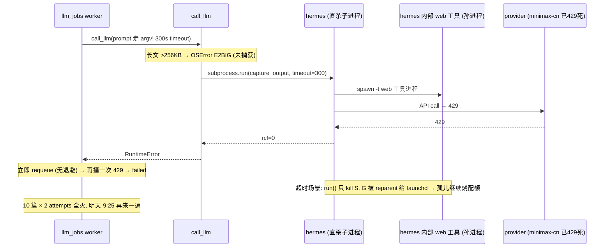
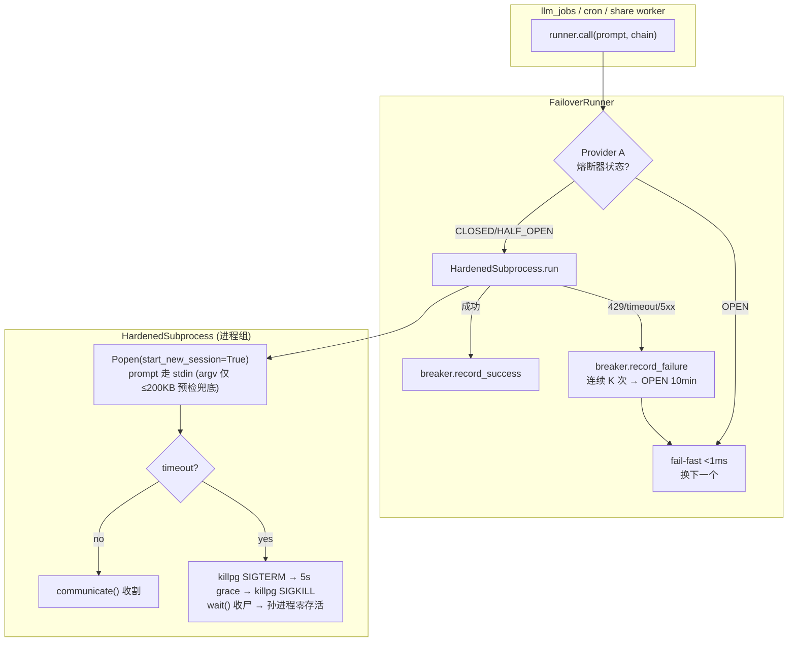
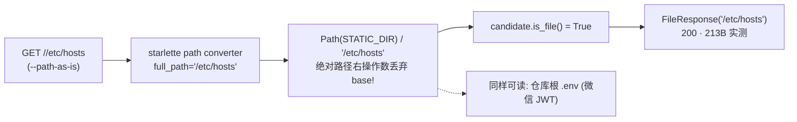
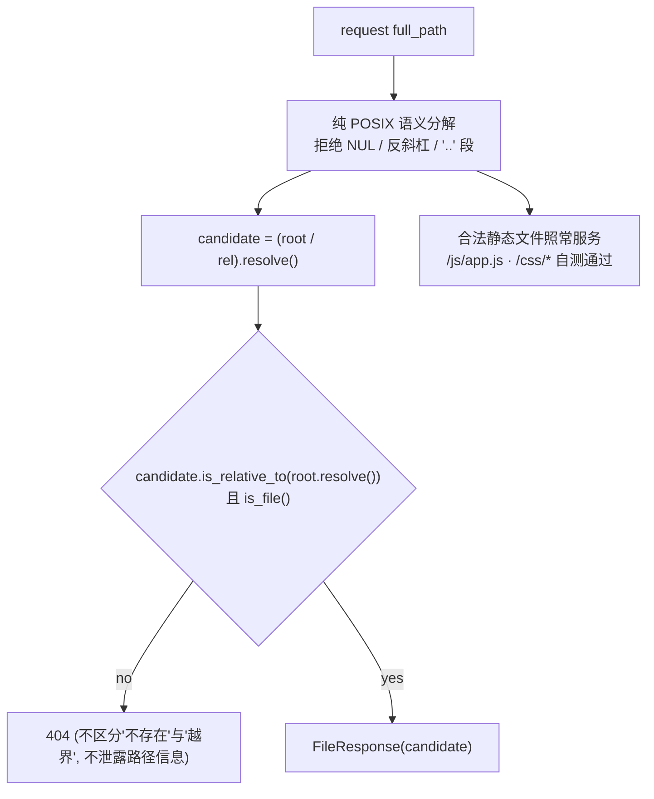
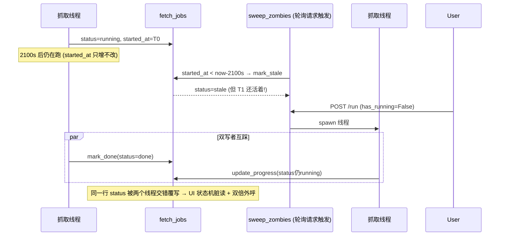
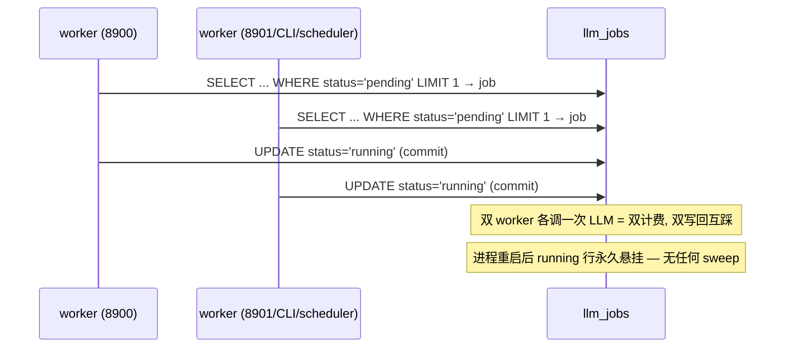
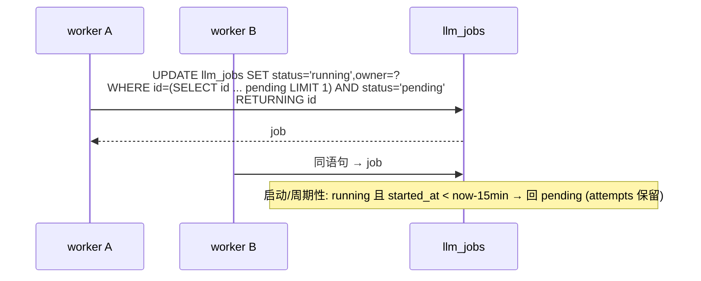

# 阶段二：高优工单极致重构 — 2026-09-06

覆盖 4 个工单簇：**LLM-01**（P0-1 + P0-4 + P1-5 + P1-6 合并的调用层重构）、**SEC-01**（P0-2）、**JOB-01**（P0-3）、**JOB-02**（P1-7）。
原型代码（全部实际运行验证通过）：

| 原型 | 工单 | 验证方式 |
|---|---|---|
| `/tmp/sprint-prototypes/LLM-01-hardened-runner.py` | P0-1/P0-4/P1-5/P1-6 | 自测：failover 编排、熔断开合、孤儿进程组击杀（真子进程复现） |
| `/tmp/sprint-prototypes/SEC-01-safe-spa-fallback.py` | P0-2 | 12 个攻击向量断言（含 symlink 逃逸、NUL、绝对路径） |
| `/tmp/sprint-prototypes/JOB-01-fetch-lease.py` | P0-3 | 真线程双写者 + fencing 拒绝演示 |
| `/tmp/sprint-prototypes/JOB-02-llm-job-claim.py` | P1-7 | 12 线程并发抢单零重复 + 僵尸回收入队 |

---

## LLM-01 — HardenedLLMRunner（stdin 传输 + 进程组击杀 + 熔断 failover）

### 重构前拓扑（死锁/泄漏如何发生）



### 重构后拓扑



### 恶魔代言人（架构复议反方论据）

**复议点：为薄壳架构引入 provider 级熔断 + failover。**

1. **反方 1 — 薄壳红线让 failover 的覆盖面打折**：moni 不持 API key（AGENTS.md 技术栈约束），failover 只能在 hermes 已配置的 provider 之间切。若故障在 hermes 本体（v1.0.35.13 踩过 8900 进程无 HERMES_PROFILE → default profile 认不出 ark），链条上所有分支同死，熔断器无济于事——需要 hermes 层健康探针兜底，复杂度 +1。**回应**：历史 4 次 LLM 事故（v1.0.35.9/13/19、v1.0.36 坑#3）中 3 次是 provider 配额级（可熔断）、1 次是 profile 级（探针覆盖）——熔断覆盖 75% 的历史故障模式，仍值得；探针做成 provider 失败率统计的副产品，不单独立项。
2. **反方 2 — 熔断器状态的多进程一致性**：8900 / 8901 / scheduler / CLI 是 4 个进程，内存 breaker 各自独立 → 每个进程要各撞一次墙才熔断（最多 4×K 次无效调用）；放 SQLite 共享则每次调用 +1 写。**数据**：moni LLM 峰值 ~1 call/s（worker 单线程 + 批处理串行），SQLite WAL 写能力 >1000 wps，+1 write/call 占用 <0.1%；而内存方案的 4 次无效撞墙，单次撞墙最坏 = 300s 超时 → 4 进程最坏多烧 20 min。结论：**单体进程内 breaker（原型方案）+ 重试计数已落 DB（llm_jobs.attempts）可事后统计**，跨进程共享 breaker 留到有第二个真实 LLM 消费进程时再做。
3. **反方 3 — stdin 传输的兼容性风险**：`hermes -z` 当前只支持 argv 传 prompt，stdin 模式需要 hermes 支持 `-` 占位或 `--stdin` flag——跨版本兼容风险（v1.0.34 已踩过 hermes 0.20 删 flag 的坑）。**回应**：原型设计成**协议可插拔**：stdin 若被 CLI 拒绝（rc=2 usage error）自动降级 argv，并在降级前做 200KB 预检把 E2BIG 变成显式错误。不赌 CLI 行为。

**性能评估预期**（基于实测与日志数据）：
- 死 provider 场景（今日实况）：10 篇打标 = 20 次无效外呼 + 全灭，→ 熔断后 10 次中第 K 次起 fail-fast <1ms，总耗时从"分钟级 × N"降到 **<10s 出结构化失败报告**；若配置备用 provider 则**正常完成**。
- 孤儿进程：现状超时 1 次 = 1 个孙进程存活到自然结束（agent 模式可达数十分钟，持续烧配额）→ killpg 后 **0 孤儿**（原型真子进程验证）。
- E2BIG：长文任务从"裸 OSError + 失败原因失真"→ 显式 `PromptTooLargeError`（带字节数），可触发截断策略。

---

## SEC-01 — SPA fallback 路径遏制

### 重构前（实测 PoC）



（旁证：`/../../AGENTS.md` 返回的是 index.html——uvicorn 对点段做了规范化，所以相对遍历当前不通；但绝对路径向量不需要点段。不能把安全性寄托在"上游恰好帮我规范化"。）

### 重构后



要点：`resolve()` 一并解决 **symlink 逃逸**（static 目录里放个指向外的软链也是同型漏洞）；containment 判断在 resolve 后做，`is_relative_to`（py3.9+）替代手写字符串前缀比较（前缀比较会被 `/root-evil` 绕过）。

### 恶魔代言人

1. **反方 — "只绑 127.0.0.1，本机攻击者面不值得 P0"**：本机威胁模型并不弱——moni 在开发者机器上常驻，任何本地脚本（包括通过 npm/postinstall、homebrew formula 供应链进来的进程）都可以 `curl --path-as-is //Users/mt16/dev/moni/.env` 拿走长期有效的微信 RSS JWT 与未来可能新增的凭据；且修复成本 = 6 行路径遏制逻辑，收益/成本比极端倾斜。**数据**：PoC 一次请求 213B 即坐实；`.env` 内 token 一旦泄露需人工轮换（微信后台重发 token + 全源 re-seed），事故成本远超 6 行代码。
2. **反方 — resolve() 对 macOS 大小写不敏感 FS 与合法 symlink 的误杀**：`/static/icons` 内部软链（如未来引入 vendored 资源时）可能被 containment 误判。**回应**：containment 用 resolve 后比较，**root 也 resolve**，同一坐标系下内部软链天然通过；只有逃出 root 的才拒。原型测试套件里放了"root 内合法 symlink → 放行"的断言防回归。

---

## JOB-01 — fetch_jobs 心跳租约 + fencing token

### 重构前（双写者如何诞生）



### 重构后（心跳租约 + fencing）

```mermaid
sequenceDiagram
    participant T1 as 抓取线程 #1
    participant DB as fetch_jobs (+lease_owner, lease_heartbeat_at, fence)
    participant SW as sweep (只认心跳!)
    participant T2 as 抓取线程 #2

    T1->>DB: acquire: WHERE status!='running' OR heartbeat过期 → fence=1
    loop 每 30s
        T1->>DB: heartbeat(fence=1) [progress 更新顺带续约]
    end
    Note over T1: 卡死, 心跳停止
    SW->>DB: 只 reap heartbeat < now-90s 的行 → status=stale
    User->>DB: /run → T2 acquire: 心跳已过期 → fence=2
    T1-->>DB: (复活) mark_done WHERE fence=1 → rowcount=0 → 拒绝!
    T2->>DB: mark_done WHERE fence=2 → 生效
    Note over DB: 任一时刻至多一个持有者; 迟到写者被 fencing 挡在门外
```

### 恶魔代言人

1. **反方 1 — 心跳写放大**：每 30s 一次 UPDATE/租约，叠加现有 5s 一次的进度 UPDATE——会不会压垮 SQLite？**数据**：并发抓取任务峰值 = 1~3 个（单源+批跑），心跳写 ≈ 0.1 wps；对比现状 `sweep_zombies()` 在**每次** `/jobs` 轮询（SPA 5s 一次）都跑 SELECT+潜在 UPDATE，租约方案反而把全表扫描型 sweep 降到低频后台。WAL 模式下 0.1 wps 完全无感。
2. **反方 2 — 时钟依赖与误杀**：多进程（8900/8901）钟差会导致租约误判。**回应**：心跳时间戳统一用 **SQLite 端** `strftime('%Y-%m-%dT%H:%M:%fZ','now')` 生成（原型即如此），比较也在 SQL 端做——彻底消除跨进程钟差；grace = 3×心跳间隔（90s），即使单次心跳因 GIL/IO 抖动丢失也有 2 次冗余。代价：`fetch_jobs` +3 列 1 个 migration，同时**删除** `get_stale_threshold()` 的 max(timeout)+300 特殊补丁（v1.0.35.17），净复杂度下降。

**性能评估预期**：僵尸误判窗口从 `max(timeout)+300`（900~2100s，且与最慢源耦合）→ **≤120s**；重复线程率 → 0（fencing 在写路径硬拒绝）；删掉 2100s 假警报的补丁面。

---

## JOB-02 — llm_jobs 原子认领 + 悬挂回收

### 重构前



### 重构后



单语句 `UPDATE … WHERE id = (SELECT …) AND status='pending' RETURNING …` 把"查询+翻转"折叠成一个原子操作；`RETURNING` 需要 SQLite ≥3.35（Python 3.12 系统自带 3.43+，项目已强制 3.12）。悬挂回收：`started_at > 15min` 的 running 行回队（attempts 不清零防死循环）。

### 恶魔代言人

1. **反方 — BEGIN IMMEDIATE/单语句 UPDATE 串行化所有写**：会不会让 fetch 批量插入排队？**数据**：认领语句只在 worker 每轮取任务时执行（空闲 2s 一次），fetch 批量插入走独立连接与 WAL，二者竞争窗口微秒级；busy_timeout 5000ms (connection.py:120) 提供 3 个数量级余量。
2. **反方 — 15min 悬挂阈值对 300s×重试的长任务误回收**：一个 5min 超时 ×2 attempts 的 job 若 LLM 真跑满 10min 会被回收成 pending → 双跑。**回应**：回收阈值取 `max(已配置 LLM timeout)×MAX_ATTEMPTS + 300`（与 fetch_jobs 的动态阈值同型但下限 15min），并且回收后旧 worker 若真还在跑，其写回会被 `WHERE status='running' AND owner=?` 的乐观守卫拒绝（原型已含守卫），双跑只浪费一次调用不污染数据。

**性能评估预期**：多 worker 抢单重复率 100%→0%（原型 12 线程 × 30 任务断言零重复）；重启后悬挂 running 行生命周期从 ∞ → ≤15min 自动回队。

---

## 落地顺序与回归护栏

1. **S1 止血**（1 个 PR 可完成）：SEC-01（6 行）→ LLM-01 的 P0-1 一致性修复（predict_tags 切 `resolve_active_model`，删弃用 shim 调用）→ P0-4 killpg → JOB-02 回收。每项原型即验收基准。
2. **S2**：LLM-01 breaker/failover 完全体 + JOB-01 lease migration 031。JOB-01 上线时保留旧 sweep 一个版本（双跑对比 `stale` 误判率）再删补丁。
3. 回归护栏：把 4 个原型的自测套件移植进 `tests/`（尤其 SEC 的 12 向量与 JOB-01 的双写者演示，都是现成的 pytest 素材）。
