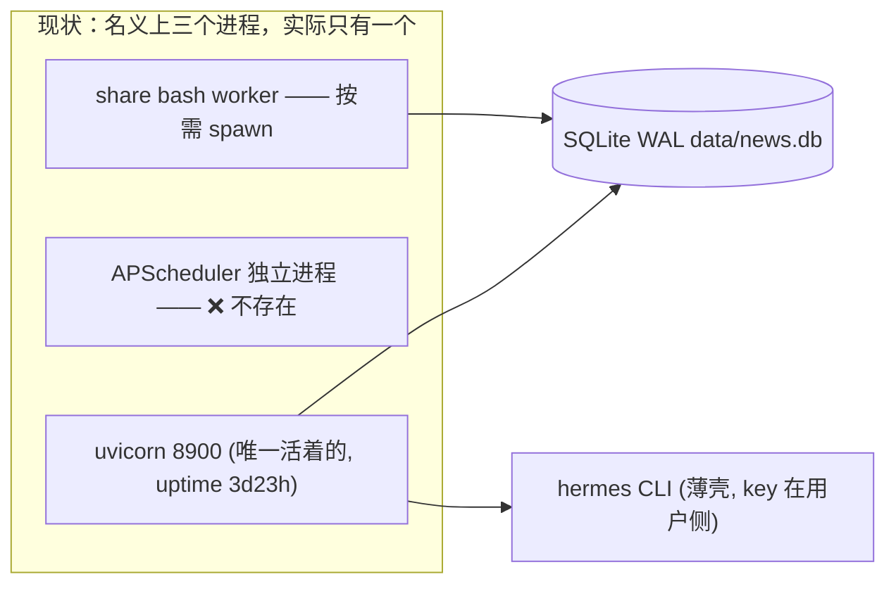
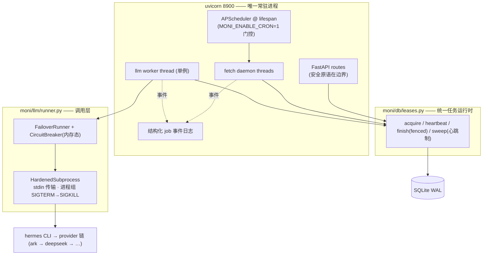

# moni 工程继任指导书（Succession Engineering Plan）

> 写给下一个接手 moni 的人（人或 agent）。
> 本文是**方案**，不是变更记录——文中所有代码都未落地，只有 `/tmp/sprint-prototypes/` 的 4 个验证原型和 `docs/sprint-audit-2026/` 下的审计文档。
> 配套阅读顺序：本文 → `BACKLOG.md`（20+1 张工单的证据链）→ `PHASE2-REFACTOR.md`（4 个核心重构的图纸）→ `AGENTS.md` 踩坑史。
> 全文 File:Line 均在 branch `exhaustive-mode`（审计日 2026-09-06）下有效，若行号漂移以符号名为准。

---

## 0. 这份文档的立场

审计已经证明 moni 的**产品主干是能打的**：抓取→过滤→入库→分享链路 783 个 done 的 fetch job、11 个源、780 个测试。真正的问题不在"功能缺失"，而在三个**结构性的工程债**上：

1. **任务状态机没有"活性证据"** —— 判死看墙钟起点，不看心跳；判死后原线程还活着；没有任何机制阻止两个写者碰同一行。
2. **AI 集成层把可靠性寄希望于"别出事"** —— 单 provider 无降级、重试无退避、子进程超时留孤儿、prompt 走 argv 有硬上限。而 LLM 恰恰是这条链上最不可靠的外部依赖。
3. **"自动"是纸面的** —— schedule.yaml 注册 6 个 job，运行时一个调度进程都没有，5 个 job 从未执行过。

因此本文的所有建议都围绕一句话展开：**把"系统是否健康"从"看起来在跑"变成"有证据在跑"**。下面每个设计都能追溯到一条已实测的证据。

---

## 1. 系统现状一页纸（继任者先建立这个心智模型）



**关键数字**（2026-09-06 只读普查，命令见 §8）：

| 指标 | 值 | 对应工单 |
|---|---|---|
| llm_jobs 失败率 | 73/(98 done+73 failed) ≈ **43%** | P1-5/P0-1 |
| llm_jobs 悬挂 running | 1 条 >15min（无回收机制） | P1-7 |
| fetch_jobs stale | **187 条**（started_at 判死机制的累计误伤） | P0-3 |
| schedule.yaml job 执行记录 | 6 注册 / **5 从未跑过** | P0-5 |
| 此刻活的 `hermes --provider minimax-cn` 进程 | 2 个（429 死 provider） | P0-1/P0-4 |
| `except Exception` | 181 处，无 lint 门禁 | P1-12 |

**进程/数据流要点**：
- `moni/web/server.py` 是唯一常驻进程；路由同步执行跑 anyio 线程池（~40 线程）。
- fetch 任务 = 路由里 `threading.Thread(daemon=True)` 起来就不管（`web/routes/fetch.py:224,638`）；LLM 任务 = 进程级单例 worker 线程（`llm/jobs.py:165-180`）。
- DB 连接 = 每线程私有（`db/connection.py`，v1.0.37.5 后），WAL + busy_timeout 5000ms。
- LLM 调用 = `subprocess` 打 `hermes -z`，key 全在 hermes 用户配置里，moni 不持 key（薄壳红线，不可破）。

---

## 2. 五个结构性判断（改什么、为什么是它）

### 判断 1：三条任务状态机要统一成一个"租约运行时"，而不是各自打补丁
fetch_jobs（`fetch/jobs.py`）、llm_jobs（`llm/jobs.py`）、share_tasks 是三套手写的 SELECT/UPDATE 状态机，各有各的竞态和死法。v1.0.35.17 的 `get_stale_threshold()=max(timeout)+300`、v1.0.7.6-hotfix.1 的 409 fallback、llm/jobs.py:235 的"我们假设单进程"注释——**全是同一类病的不同症状**：没有租约语义。继任者不要继续给每条状态机单独贴膏药，做一次原语下沉（见 §4-S2 的 `moni/db/leases.py` 设计），之后所有任务表只有一种正确的用法。

### 判断 2：LLM 层需要一个真正的"调用层"，现在只有一串函数
`llm/client.py` 是"怎么发请求"，但缺"谁值得信任"：无 provider 健康记忆、无降级、无进程组管理、无传输上限。这不是加个 try/except 的事，是一个 `FailoverRunner + CircuitBreaker + HardenedSubprocess` 的薄组件（原型已验证）。薄壳红线不变：moni 仍然不持 key，failover 只在 hermes 已配置的 provider 间切换。

### 判断 3：调度器的归宿是"web 进程内嵌"，不是复活独立进程
原设计（`cron/scheduler.py` docstring"SEPARATE process"）从未真正运行过，这本身就是数据：**需要单独伺候的进程在这个项目里活不下来**。8900 uptime 3d23h 证明 web 进程才是唯一可靠的常驻物。所以把 APScheduler 放进 web lifespan 启动（用环境变量门控防 8901 dev 双跑），任务重启存活问题交给判断 1 的租约解决。这是本计划里唯一一处"推翻既有设计决策"，恶魔代言人论证见 §5-拍板项 2。

### 判断 4：安全修复要做成"原语"而不是"补丁"
P0-2 路径穿越的根因是 `Path(base) / user_path` 这个 API 陷阱；P1-9 的根因是 `:href` 绑定没有 scheme 白名单；P1-10 的根因是 API 边界没有脱敏层。三个问题的共同解法是各引入一个 6-20 行的纯函数原语（`resolve_static_path` / `safe_href` / `sanitize_source_url`），在**唯一入口**强制走，而不是逐点修。

### 判断 5：先决定"要不要"，再决定"怎么修"
`predict_tags_pending` 死了 13 天无人发现（P0-1），`PUT /api/fetch/sources` 是个没人调用的扇出地雷（P1-11）。继任者的第一反应不应该是修，而是**确认它们还该不该存在**。删掉一个没人要的功能，比修好它更符合工程价值。

---

## 3. 目标架构（Sprint 全部完成后长什么样）



**设计原则**（继任者写代码时对着自查）：
1. 每个后台任务必须有租约；无租约的状态写一律不许落库。
2. 每次外部进程调用必须进程组化 + 超时升级；每次外部 LLM 调用必须过熔断器。
3. 每个面向用户的渲染点必须过安全原语；每个 API 出栈必须脱敏。
4. 每个"判死"决策必须基于心跳，不许基于墙钟起点。
5. 失败必须可见：不许 `except: pass` 静默吞（lint 门禁强制）。

**反目标（明确不做，防止过度工程）**：
- ❌ 不引入 Celery/Redis/RQ——SQLite 租约对这个量级（峰值 1 写/s）绰绰有余。
- ❌ 不迁 Postgres——单机单用户，WAL 够用，迁移成本纯负收益。
- ❌ 不重写前端框架——Alpine v3 留着，只做 vendored + 生命周期治理。
- ❌ 不做跨进程分布式熔断器——单 web 进程 + attempts 落 DB 的统计够用，等出现第二个真实 LLM 消费进程再说。
- ❌ 不把 hermes 抽象掉——薄壳是架构决策不是巧合，key 管理永远留在用户侧。

---

## 4. 执行蓝图（S1 → S4，按"止血→正确性→安全→工程化"排序）

> 每票给出：改动清单（文件级）、设计要点、边界条件、验收基线、预估量。原型在 `/tmp/sprint-prototypes/`，其自测即验收基线。

### S1 —— 止血（目标：1-2 个 PR，一个下午到一天）

#### S1-1 【P0-2】SPA 路径穿越（0.5h）
- 改动：`web/server.py:116-126` 的 `spa_fallback` 内两行，替换为 `resolve_static_path(STATIC_DIR, full_path)`（原型 `SEC-01-safe-spa-fallback.py` 整函数可用）。
- 边界：NUL/反斜杠/`..`段/symlink 逃逸/`/root-evil` 前缀绕过——原型 14 向量全断言。
- 验收：14 向量测试移植进 `tests/test_spa_fallback.py`；手工 `curl --path-as-is //etc/hosts` 返 SPA fallback 内容（216KB 的 index.html）而非 213B 的真文件。
- 回滚：单函数 revert。

#### S1-2 【P0-4】进程组击杀（2h）
- 改动：`llm/client.py:174-184` 与 `share/worker_llm.py:249-262` 两处子进程调用，统一换 `run_subprocess_group()`（原型 `LLM-01-hardened-runner.py`）。
- 设计要点：`start_new_session=True` → pgid==pid；超时 `killpg(SIGTERM)` → 5s grace → `killpg(SIGKILL)` → `wait()` 收尸；二次 `communicate()` 排干管道；`ProcessLookupError` 竞态静默通过。
- 验收：原型的孙进程复现测试（真子进程 + `os.kill(pid,0)` 断言死亡）移植为 pytest。
- 回滚：两处调用点独立可 revert。

#### S1-3 【P0-1 + 拍板 1】predict_tags：先拍板再动手（1h）
- 若拍板"退役"：`config/schedule.yaml` 删条目 + `cron/jobs.py:247-424` 标记 deprecated 或删除 + 删 `llm/client.py:277-303` 的 `ChatClient` 弃用 shim（唯一调用者就是它）。
- 若拍板"保留"：`cron/jobs.py:343-348` 换 `resolve_active_model()` + `call_llm()`（与 `extract_events_pending` 同款，v1.0.35.19 已趟平的路）；删除 shim。
- 我的推荐：**退役**。理由见 §5-拍板项 1。

#### S1-4 【P1-7】llm_jobs 悬挂回收 + 原子认领（2-3h）
- 改动：migration 032（`llm_jobs` 加 `owner TEXT`、`fence INTEGER DEFAULT 0`）；`llm/jobs.py:234-257` 认领换单语句 `UPDATE…WHERE id=(SELECT…) AND status='pending' RETURNING…`（原型 `JOB-02`，含 SQLite<3.35 的 BEGIN IMMEDIATE 退路）；worker 启动时 + 每轮 poll 调 `requeue_stuck(stale_after=15min)`；`_run_job` 写回加 `AND owner=?` 乐观守卫。
- 边界：回收阈值 ≥ max(LLM timeout)×MAX_ATTEMPTS+300；attempts 保留防死循环；僵尸迟到写 rowcount=0 需记日志（这正是 P1-12 要的可见性）。
- 验收：原型 12 线程×30 任务零双抢 + 悬挂回收断言，移植 pytest。

#### S1-5 【P0-5 + 拍板 2】调度器归宿落地（2h）
- 按拍板结果执行；我推荐方案 B（web lifespan 内嵌，详见 §5-拍板项 2）：
  `web/server.py` lifespan 里 `MONI_ENABLE_CRON=1` 时启动 `BackgroundScheduler`（`misfire_grace_time=300`、`coalesce=True`）；8901 dev 与测试进程默认不启。`/api/service/status` 增报 scheduler 存活。
- 边界：**8901 绝不能同时开调度**（双端口同 DB，双跑 = 任务重复）——环境变量门控是硬闸不是注释。

### S2 —— 并发正确性（目标：一个 PR 链，2-3 天）

#### S2-1 【P0-3】统一租约运行时（1-1.5 天，本计划最大单项）
- 新模块 `moni/db/leases.py`：`acquire/heartbeat/finish(fenced)/sweep_expired` 四原语（原型 `JOB-01-fetch-lease.py` 即实现本体）。fetch_jobs 与 llm_jobs 都改走它。
- 改动清单：
  - migration 031：`fetch_jobs` 加 `lease_owner/lease_heartbeat_at/fence` 三列。
  - `fetch/jobs.py`：`sweep_zombies()` 重写为心跳制（删 `get_stale_threshold()` 和 `STALE_THRESHOLD_SECONDS` 整段补丁，`fetch/jobs.py:27-69`）；`has_running()` 改查租约；`mark_done/mark_failed/mark_timeout` 全部 fence 化。
  - `web/routes/fetch.py:273-360` `_run_fetch_job`：启动时 acquire（拿 fence），后台线程每 30s 心跳（直接挂在既有 `_persist_progress` 的 UPDATE 上顺带续约，零额外写路径）；终态写走 `finish(fence)`。
  - 超时机制保留（progress_callback 抛 TimeoutError），但**判死不再依赖它**。
- 边界：grace=3×心跳间隔（90s）；时间戳一律 SQLite 端 `strftime('now')`（跨 8900/8901 钟差免疫）；migration 在 8900 停机窗口执行（SOP 见 §6）。
- 验收：JOB-01 原型两段演示（顺序生命周期 + 4 线程单胜者）移植 pytest；上线后观察一周 `stale` 增量应 ≈0（现状 187 是基线）。
- 兼容策略：旧 `sweep_zombies` 保留一个版本双跑对比误判率，再删。

#### S2-2 【P1-5 + P1-6】LLM 调用层完全体（1 天）
- 新模块 `moni/llm/runner.py`：`FailoverRunner` + `CircuitBreaker` + stdin 传输 + 200KB argv 预检（原型 `LLM-01-hardened-runner.py`）。
- 配置：`llm_settings` 新 key `fallback_model_ids`（CSV，按优先级），无则退化为单 provider——schema 增量走 migration，不硬编码。
- 改动：`llm/jobs.py:316` 的 `call_llm` 换 `runner.call(prompt)`；`share/worker_llm.py` 的 `run_hermes` 收敛到同一 subprocess 原语。
- 边界：stdin 被 hermes 拒绝（rc=2）自动降级 argv + 预检报 `PromptTooLargeError`（不赌 CLI 版本行为）；熔断 `failure_threshold=2, reset_timeout=600s`，内存态 + `llm_jobs.attempts` 已有落库统计。
- 验收：原型 failover/熔断/预检三段断言移植 pytest；上线后 43% 失败率应显著下降（provider 死时从"每任务 2 次慢失败"变"1 次 fail-fast + 结构化报告"）。

#### S2-3 【P1-8】predict_tags 互斥 + misfire 预算（0.5 天）
- 打标 job 用一条合成锁行（`cron_runs` 或独立 `job_locks` 表）走租约 acquire；`cron/scheduler.py:72-79` `misfire_grace_time` 60→300（fetch_all 串行长尾的现实是 30+ 分钟，60s 的 grace 等于没有）。
- 顺带：`cron/jobs.py:216-238` 与 `web/routes/fetch.py:811-826` 的 `except: pass` 换成 `logger.error` + `extra` 字段标记（P1-12 的第一批，人工改这两处即可，其余等 lint）。

### S3 —— 安全与前端（目标：一个 PR 链，2 天）

#### S3-1 【P1-9】`:href` scheme 白名单（0.5 天）
- 新原语 `static/js/safe-url.js`：`safeHref(url)` — 仅放行 `http:/https:`，其余返回 `null` 并由模板降级为纯文本渲染；全库 `:href` 绑定点过一遍（`index.html:268,312,614,932,1233,1397,2824,2964,3020,3073`），同场补 `rel="noopener noreferrer" target="_blank"`。
- 验收：手工清单 + 一个 node 单测跑 `safeHref` 真值表（`javascript:`、`data:`、`vbscript:`、大小写混淆、`java\tscript:` 变体）。

#### S3-2 【P1-10】source url 出栈脱敏（0.5 天）
- 新原语 `moni/web/redact.py: sanitize_source_url(url)` — query 里 `token=` 值替换为 `…`（保留参数名提示存在凭据）；`config_sources.py` 的 list/create/update 响应（L102/173/211 等出栈点）统一过它。
- PUT 语义：收到打码值 = "未修改，保留原值"；收到完整新 URL = 覆盖。**先写测试再写实现**——这是最容易做错语义的地方。
- 展示生成器 `token=SHOWCASE` 的既有打码逻辑迁来复用，消灭两套实现。

#### S3-3 【P2-13】前端生命周期治理（1 天）
- `pollManager` 小助手（keyed start/stop，view 切换统一 teardown）；`loadLlmJobs`（`app.js:4296-4303`）改为受管轮询。
- `showArticleDetail`（`app.js:3724-3735`）与 `openJobDetail`（`app.js:4388-4396`）加 AbortController + 序号守卫（响应落地前比对当前 id）。
- `articleEvidenceList` 在 open/close（`app.js:3723,3737-3741`）重置；`restartService`（`app.js:186-201`）先 clear 旧 interval 再起。
- 验收：无自动化设施，列 8 条手工回归清单进 PR 描述（点击 A→B 快速切换、重启按钮双击、LLM tab 停留后切走查 Network 面板归零）。

#### S3-4 【P2-14 + P2-15】CDN 自托管 + modal 转义（0.5 天）
- Alpine 3.14.1 + GSAP 下载进 `static/js/vendor/`，`index.html:19,3772-3773` 改本地引用（离线 demo 约束从此不再依赖网络）；注意 `scripts/build_showcase_html.py` 若引用 CDN 路径需同步。
- `modal.js:238,245-246` 的 title/按钮文案走 `_escapeHtml`（app.js:2660 已有实现，复用）。

### S4 —— 工程化（目标：门禁立起来，1-2 天）

#### S4-1 【P2-16】CI
- `.github/workflows/ci.yml`：3.12 + `pip install -e .` + `pytest -p no:cacheprovider` + `ruff check`。private repo Actions 免费额度 2000 min/月，本套件单跑约 3-5 min，预算充裕。YAML 骨架见 §6.3。注意 `.env` 不存在 → 需要 `moni db init` + seed 步骤或依赖 conftest 现有隔离（先本地 `act` 或干跑验证一遍再上线）。
- 分支保护：**不可用**（PRIVATE 无 Pro，API 403 实测）——CI 绿只能当看板。若未来转 public（拍板项 4）再补 required checks。

#### S4-2 【P1-12】ruff 门禁分阶段
- 阶段 1：`pyproject.toml` 加 ruff，仅启用 `E9/F63/F7/F82`（真错误）+ 新规则白名单模式，存量 181 处 `except Exception` 进 per-file-ignore。
- 阶段 2：`BLE001` 只对 `moni/` 新增代码生效（CI 里对 diff 文件跑），存量随 S2-S3 改造逐步清出。
- 禁止一把梭全开——181 处一次修完既不现实也会淹没真信号。

#### S4-3 【P3-18/19】层界与连接层清淤（0.5 天）
- `llm/jobs.py:60-67` 的反向 import：把 `DOMAIN_WHITELIST`/时效三件套下沉到 `moni/llm/gates.py`，routes 反向引用它（依赖方向：web → llm，不许倒流）。
- `connection.py:151-158` 删伪锁（`_LOCAL` 是线程私有，`_CREATE_LOCK` 无物可护）；`_RETIRED` 改为 retire 即 close（安全：thread-local 所有权下无并发持有者）；`llm/jobs.py:28-30` 的 `check_same_thread=False` 谎言注释删掉。

---

## 5. 拍板项（继任者需要项目所有者确认的 4 个决策，附我的推荐）

### 拍板 1：predict_tags_pending 修还是退？—— 推荐：**退**
- 事实：死 13 天无人发现；43% LLM 失败率时期从未有过用户投诉缺失；tag 体系已由 `tag_filter` + 全局关键词（v1.0.40）覆盖主要入口。
- 反方论据（ Devil's Advocate）：① "退了以后想再加要重做"——错，事件抽取管道就是现成模板，重建成本 ≈1h；② "它便宜"——不便宜：它是 43% 失败率的贡献者、每日无效外呼、和一个永远修不完的弃用 shim。
- 若退：S1-3 按"退役"分支执行；LLM 自动打标的需求若复活，在 S2-2 的 runner 上重建（半天内）。

### 拍板 2：调度器归宿？—— 推荐：**方案 B，web 进程内嵌**
| 方案 | 说白了 | 恶魔代言人反方 | 数据 |
|---|---|---|---|
| A. 复活独立进程 | 回到原设计 docstring | 需要单独的启停/巡检/重启恢复——**这正是它从未活过的原因**；多一个 PID 多一类死法 | 8900 uptime 3d23h vs scheduler 0 天 |
| B. web lifespan 内嵌（推荐） | 跟着唯一常驻进程活 | ① web 重启杀掉 in-flight job——租约运行时自动回收重跑，伤害 ≤1 个 job；② uvicorn `--reload` 双跑——MONI_ENABLE_CRON 门控硬闸；③ 慢 job 占线程池——APScheduler 自带 ThreadPoolExecutor，任务全 I/O 型 | 运维面：1 个进程；新依赖：0 |
| C. launchd plist | OS 托管最正统 | macOS 绑定（可接受，平台本就 darwin）；多一个 plist 配置面，agent 难自查；调试走系统日志链路 | 标准化最高，可观测性最差 |

B 的本质是：**用租约运行时消化"进程会死"，换取"进程数量最少"**。

### 拍板 3：`PUT /api/fetch/sources` 修还是删？—— 推荐：**删**
- 事实：SPA 只用 `/run` 和 `/ping`（实测 grep）；config CRUD 的正路是 `/api/config/sources`；这个端点还带着"单源更新扇出全源"（`web/routes/fetch.py:153-163`）和非原子 YAML 写两颗雷。
- 保留的代价 = 修扇出 + 加目标过滤 + tmp+rename 原子写 + 锁，全为一个无人使用的端点。删除 = `routes/fetch.py:139-169` 一个函数。没有反方能赢这个性价比。

### 拍板 4：repo 转 public？—— 推荐：**维持 PRIVATE，护栏走本地门禁**
- 转 public 解锁分支保护 + secret push protection + CodeQL（免费档），且 AGENTS.md 说 STATUS/USER_GUIDE/README 本就"公开可见"。
- 反方：① 申报/参赛材料的排他性；② 历史 demo/截图路径在 gitignore 里但仓库可见性变更会放大任何未来误提交的爆炸半径；③ `.env` 曾含微信 JWT——虽然未入库，但 push protection 的价值恰恰是"防未来"。
- 结论：不转。护栏由 CI 绿标 + ruff 分阶段门禁 + PR checklist 承担；等有真实的对外展示需求再单独立项。

---

## 6. 实施纪律（继任者的操作约束，均有历史事故背书）

### 6.1 PR checklist（从审计教训提炼，PR 描述里贴上逐条勾）
- [ ] 新代码零 `except Exception: pass`（必须吞时：注释写明为什么 + logger.debug）
- [ ] 子进程调用 = 进程组化 + 超时升级（不许裸 `subprocess.run(timeout=)` 出现在新代码）
- [ ] LLM 调用走 runner（不许直连 `call_llm` 新增调用点）
- [ ] 用户数据参与 Path 拼接 = 必须 resolve + containment
- [ ] 任务状态写入 = 必须走租约原语（fence 校验）
- [ ] SQL 全参数化（表名插值仅限内部白名单枚举）
- [ ] 新前端依赖 = 必须 vendored，禁止新 CDN 引用
- [ ] DML 后、HTTP 断言前 `commit()`（v1.0.37 教训）
- [ ] 迁移 SQL 带回滚语句（`ALTER TABLE` 的回滚 = 新列保留无害，写明即可）

### 6.2 涉及 live DB 的迁移 SOP（S2-1 必经）
```
1. 停 8900（scripts/web.sh stop 或 kill PID，确认 pgrep 空）
2. 备份：sqlite3 data/news.db ".backup data/backup-pre-031-$(date +%Y%m%d).db"
3. 跑 migration（031/032），确认 pragma integrity_check 干净
4. 用绝对路径启 8900（/usr/local/bin/python3 -c "..."，AGENTS.md 部署节原样复制）
5. 冒烟：/health 200；/api/stats 正常；打一次单源 dry-run fetch
6. 更新 STATUS/USER_GUIDE/HANDOFF（Session 收尾 checklist）
```

### 6.3 CI YAML 骨架（落盘即用，按拍板 4 决定是否启用）
```yaml
name: ci
on: [push, pull_request]
jobs:
  test:
    runs-on: macos-14        # SQLite/WAL 与 macOS 行为一致性优先
    steps:
      - uses: actions/checkout@v4
      - uses: actions/setup-python@v5
        with: { python-version: "3.12" }
      - run: pip install -e . && pip install ruff pytest
      - run: set -a && source .env.example 2>/dev/null || true; set +a
      - run: python -m moni db init || true
      - run: pytest -p no:cacheprovider tests/
      - run: ruff check moni/ --select E9,F63,F7,F82
```
（注意：runner 上无 hermes，LLM 相关测试必须靠既有 mock 层，不可真调——审计确认 mock 已覆盖，但 CI 首跑要盯 test 清单有无 import hermes 的裸依赖。）

### 6.4 发版 SOP
沿 AGENTS.md 既有链路不动：feature branch → `gh pr create --base main` → squash merge → **新 tag**（不 --force）→ 绝对路径重启 8900 → curl 5 菜单端点。S2-1 这种带迁移的 ship，把 §6.2 的 SOP 插在 merge 与 restart 之间。

---

## 7. 风险登记簿

| # | 风险 | 触发点 | 缓解 |
|---|---|---|---|
| R1 | 租约 migration 在 live DB 上执行时 8900 还活着 | S2-1 | §6.2 SOP 硬性停机窗口；备份先行 |
| R2 | hermes 拒绝 stdin 传输 | S2-2 | rc=2 探测自动降级 argv + 200KB 预检，永不赌 CLI 行为 |
| R3 | 8901 dev 双开调度器 | S1-5 | `MONI_ENABLE_CRON` 环境变量硬闸 + `/api/service/status` 报 scheduler 存活可巡检 |
| R4 | ruff 全量启用淹没信号 | S4-2 | 分阶段：真错误先行，BLE001 只对新代码 |
| R5 | fence 化改变 `mark_done` 语义，存量测试断言无条件写 | S2-1 | 先改测试再改实现；JOB-01 原型测试即新契约 |
| R6 | vendored Alpine 与 showcase 生成器路径脱节 | S3-4 | `build_showcase_html.py` 引用点同步 + demo HTML 打开验证（16.2 教训：必须浏览器实测，不能只解析） |
| R7 | predict_tags 退役后未来需求复活 | 拍板 1 | 重建路径写在 S2-2 上（runner 就绪，重建 ≈0.5 天），HANDOFF 记一行"复活指南" |
| R8 | schedule.yaml 启用后 9:10 fetch_all 与 9:25 打标重叠长尾 | S1-5 | misfire_grace_time=300 + 打标 job 租约互斥（S2-3） |

---

## 8. 继任者的第一个 90 分钟

1. **跑一遍环境自检**（全部只读，5 分钟）：
   ```bash
   curl -s http://127.0.0.1:8900/health
   pgrep -fl "hermes.*minimax-cn"          # P0-1/P0-4 是否正在发生
   pgrep -fl "apscheduler|moni.*cron"      # P0-5：应无输出
   sqlite3 -readonly data/news.db "SELECT status,COUNT(*) FROM llm_jobs GROUP BY status;"
   sqlite3 -readonly data/news.db "SELECT status,COUNT(*) FROM fetch_jobs GROUP BY status;"
   curl -s --path-as-is -o /dev/null -w '%{http_code} %{size_download}\n' http://127.0.0.1:8900//etc/hosts
   # ↑ 若 213 字节左右 = P0-2 仍在，对照 216024 = 已修
   ```
2. **跑 4 个原型**（`/usr/local/bin/python3 /tmp/sprint-prototypes/*.py`）——它们既是方案说明也是验收基线；跑不通先怀疑 Python 版本（必须 3.12）。
3. **读**：本文 §2 五个判断 → `BACKLOG.md` 证据链 → `PHASE2-REFACTOR.md` 图纸 → `AGENTS.md` 的 v1.0.35.17 / v1.0.36 / v1.0.37 三段踩坑（本计划的 R1/R5 直接源自那里）。
4. **拿着 §5 的 4 个拍板项找项目所有者过一遍**，然后从 S1-1 开始——它是 6 行代码换一个实测漏洞消除，性价比全表第一。

---

## 9. 证据与原型索引

| 资产 | 路径 | 说明 |
|---|---|---|
| 工单证据链 | `docs/sprint-audit-2026/BACKLOG.md` | 21 tickets，File:Line 实证 |
| 重构图纸 | `docs/sprint-audit-2026/PHASE2-REFACTOR.md` | 4 核心重构 Mermaid + 恶魔代言人 |
| LLM 原型 | `/tmp/sprint-prototypes/LLM-01-hardened-runner.py` | failover/熔断/进程组击杀/argv 预检，自测通过 |
| 安全原型 | `/tmp/sprint-prototypes/SEC-01-safe-spa-fallback.py` | 14 攻击向量，自测通过 |
| 租约原型 | `/tmp/sprint-prototypes/JOB-01-fetch-lease.py` | 心跳+fencing，自测通过 |
| 认领原型 | `/tmp/sprint-prototypes/JOB-02-llm-job-claim.py` | 原子认领+悬挂回收，自测通过 |
| 历史踩坑 | `AGENTS.md`（v1.0.35.17 / sprint-19 / v1.0.37 各节） | 本计划多数缓解措施的出处 |
