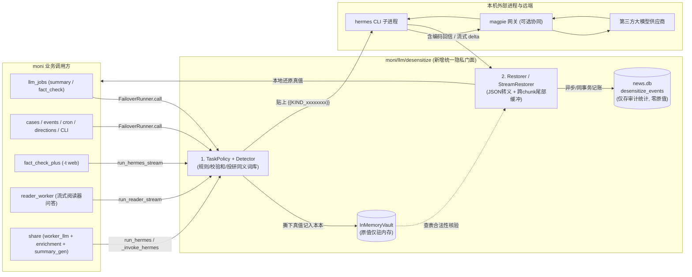

# moni「大模型信息脱敏」架构与可落地技术设计方案（方案 A：agy 版）

> **基线元数据（只读核验）**
> - 被设计系统：`/Users/mt16/dev/moni`（HEAD `247cfc0` / `v1.0.122-1-g247cfc0`，SQLite `_CURRENT_VERSION = 57`，Python 3.12）
> - 参考实现：`/private/tmp/magpie-src/magpie`（HEAD `fc4406f`）
> - 官方演示录屏：`/Users/mt16/Desktop/录屏2026-11-24 10.36.13.mov`（H.264，`1218×726`，`33.755s`，`1934` 帧）
> - 事实纪律：全文严格区分 **`[已验证事实]`**（全部附 `path:line` 源码出处）与 **`[设计判断]`**（全部附候选对比与取舍理由）。

---

## 一句话结论 + 三个支撑点

**一句话结论**：在 **moni 进程内紧贴 `hermes` 子进程的统一传输门面层（`moni/llm/desensitize/`）** 收口全部 **5 条 LLM 出站通道**，采用「**HMAC-Base32 恒定同码占位符 + 内存态零落盘映射本本 + 分任务场景自适应策略 + SQLite 审计账本**」，在不触碰任何外部 API Key、零重型/GPU 依赖的前提下，实现「发给大模型前本地撕下敏感值、模型盲态推理回信后毫秒级精准还原、全链路指标逐笔 SQL 可复算」的金融投研闭环防线。

1. **垂类语义深度（懂同业投研，不止拦通用密钥）**：除覆盖 API Key、RSS URL JWT、手机号/身份证/银行卡（带校验位与浮点数/UUID 反误判）外，原生支持**同业机构/项目全简称同义归并**（如「招商银行 / 招行 / CMB」恒定映射同一 `{{ORG_r4k7m2qa}}`，不断裂长文指代），并保护 `bv_direction` 内部研究方向标尺、关注名单与阅读器私有追问意图。
2. **任务感知与网关级零冲突互操作（5 条通道全收口，不误伤联网与生图）**：堵住「只改 `call_llm()` 会漏掉流式核查、阅读器对话、分享子进程、简报富化 4 条路径」以及「`explicit` 模式绕过 `magpie` 直连公网」的架构盲区；按任务动态切换策略（摘要/抽取/问答走双向编码还原，`fact_check_plus` 联网核查保公开主体脱私密内参，`PNG` 海报生图走单向中文泛称防编码烤入像素），且占位符正则与下游 `magpie` 字节级兼容、绝不触发二次脱敏。
3. **决赛级现场可证伪与可复算（四栏实时演练台 + 双向账本）**：补齐 `magpie` `maskrec`「还原计数仅驻内存不落盘、无业务任务关联」的短板，将每次调用的脱敏处数、类型分布、精确还原率、Token 净增减与微秒级耗时落入 `desensitize_events` 表（敏感原值永不落盘），在 `/config → 大模型设置 → 信息脱敏` 提供「原文 → 本本 → 模型收发 → 本地还原」四栏实时演练台，并直连 `/stats` 量化看板与离线单文件 `moni-web-showcase.html`。

---

## 第 0 章 前置基线核查（magpie 源码 6 问 · 官方录屏 8 步 · moni 现状 5 问）

### 0.1 `magpie` 脱敏实现源码核查（6 问逐条代码佐证）

#### M-Q1：插入点——哪一层脱敏、哪一层还原、是否对称？
- **`[已验证事实]` 出站脱敏统一位于网关路由核心层（而非各 provider 适配器内）**：
  - 插件挂载：`plugins/redact/redact.go:22-37` 在 `init()` 注册 `redact` 插件，通过 `gwmw.Mask(masking.Masker{})`（`plugins/redact/redact.go:33`）注入全局唯一 `Masker`；`internal/gateway/redact.go:32-50` `maskingFor(ctx)` 合并调用方 Key 级策略（`access.RedactOff` / `access.RedactOn`）与全局 `settings.Shared()`。若配置要求脱敏但插件未就绪或用户显式开启的本地模型崩溃，网关**默认 fail-closed** 返回 HTTP `503`（`internal/gateway/redact.go:54-56, 226-234`、`internal/gateway/gateway.go:3083-3088`）；命中 `Action == "block"` 则返回 HTTP `400` `maskBlocked`（`internal/gateway/redact.go:204-224`）。
  - 请求拦截点：主聊天/补全入口在 `internal/gateway/gateway.go:3075-3106`（另有 `count_tokens` `gateway.go:2331-2351`、路由决策 `decide_group.go:199`、向量 `embeddings.go:86`、Codex 后端 `codex_backend.go:1043` 与搜索 `codex_search.go:218`、生图/视频/转写 `draw.go:810` / `video.go:1177` / `transcribe.go:136` 的 `redactedPromptHits`、独立搜索 `gateway/redact.go:382` 的 `maskedQuery`）。在路由选定目标后、发往上游前调用 `redactedHits(maskedFor(...), capture.ResponseWriter, body)`（`gateway.go:3082`）。
  - 三项网关级路由联动：① `unredactedRoute`（`gateway/redact.go:447-456`）对全部成员均标记免脱敏的可信本地路由原样直发；② `maskRouteFor` / `RedactRouteTo`（`gateway/redact.go:525-565`、`gateway.go:3089-3101`）在命中敏感词时可将未脱敏原文自动改路由至用户指定的私有本地模型（如 `ollama/qwen3`）；③ 级联网关防重：`ownMaskedAs` + `maskedBefore` + `masking.Fingerprint`（`gateway/redact.go:288-355`、`internal/masking/fingerprint.go:24-62`）通过配置 SHA-256 指纹与构建号 `maskerSince = 3584` 避免下游 `magpie` 重复执行规则与模型扫描。
  - 提示语按协议注入：若 `maskedHits.n > 0`，在上游协议发送前由 `gateway.go:4323-4325` 调用 `withPlaceholderNote(from, attemptBody)`（`internal/gateway/placeholder_note.go:24-26, 72-87`），按 `Anthropic` / `Chat` / `Responses` / `Gemini` 四种协议在最早含占位符的消息处注入固定说明（示例码 `{{NAME_ab12cd34}}` 特意含非 Base32 字符 `1`，防被误还原且保持前缀缓存命中）。
- **`[已验证事实]` 入站还原同层包裹 `http.ResponseWriter`，整体对称但有两处刻意非对称设计**：
  - 对称包裹：`redactedHits`（`gateway/redact.go:103-105`）同步调用 `m.Writer(w)`（即 `redact.NewWriter(w)`，`internal/redact/writer.go:44`），流结束 `defer done()` 时调 `rw.Finish()` 刷出缓冲并经 `toldBack` → `maskrec.Restored(*key, c.Put())` 回写还原计数（`gateway/redact.go:110-121`）。
  - **非对称点 1（零命中仍挂还原器）**：`gateway/redact.go:98-103` 即使本轮请求 `o.h.n == 0` 未脱敏任何新词，只要脱敏开启仍包裹 `m.Writer(w)`，以还原服务端会话（如 Responses `previous_response_id` 或 Codex 压缩上下文）跨轮回吐的旧占位符。
  - **非对称点 2（出站 AST 级 `MaskJSON` vs 入站流式跨帧缓冲 `Writer`）**：出站 `MaskJSON`（`internal/redact/json.go:424-522`）跳过协议元数据键 `kept`（`model`/`id`/`tool_use_id`/`name` 等，`json.go:19-25`）与工具 schema `defs`（仅扫 `description`，`json.go:43-45`），对签名推理块 `signed`（`thinking`/`thoughtSignature`/`encrypted_content`）只做已知秘密字面量重替换以防破坏厂商签名；入站 `Writer`（`internal/redact/writer.go:62-144, 213-289`）区分整包 `whole`（`restoreJSON`）与 SSE 流式 `stream`，用 `partialTail` + `pending *held` 扣留跨事件切碎的半截占位符（如前一帧 `{{API_`、后一帧 `KEY_k3v9x2mq}}`），同时即时透传 `: keepalive` / `ping` 心跳防断连（`writer.go:126-132, 226-233`）。

#### M-Q2：检测机制——规则/正则/词典 vs 本地模型、阈值、误判权衡、保持形状（Shape）
- **`[已验证事实]` 五路检测源（`Hit.By`，`internal/redact/redact.go:900-906`）**：
  1. `ByWord`（`"word"`）：用户自定义词 `Options.Words`（`redact.go:1083-1120`），支持 `WordsAnyCase`、中日文边界感知 `WordsWhole`（`redact.go:979-1020`）及日期多写法归一 `dateSpans`；优先级最高，甚至压过 `Allow` 白名单（`redact.go:1613-1616`）。
  2. `ByYours`（`"yours"`）：用户自定义前缀或 RE2 正则 `Options.Rules`（`internal/redact/rules.go:17-35, 70-106`），上限 32 条、正则 ≤300 字符、禁匹配空串，排在内置规则前（`redact.go:1154-1158`）。
  3. `ByRule`（`"rule"`）：内置确定性规则引擎：
     - **凭据密钥（`cat == ""`）**：`redact.go:170-245` 覆盖 PEM 私钥、`sk-`（带 `notASlug` 排除 `sk-hynix-...` 新闻链接，`redact.go:525-540`）、`_sk_`、`ark-`、`ghp_`/`github_pat_`/`glpat-`、`AIza`、`xox-`、`sk_live_`、`AKIA`/`ASIA`、`hf_`/`gsk_`/`xai-`/`npm_`/`pypi-`/`SG.`、Cloudflare `cfut_`/`v1.0-`、JWT `eyJ...`、URL `user:password@host`（`hiddenInURL` 排除 `postgres:postgres@` 防仓库名污染全局记忆，`redact.go:489-512`）、键值赋值 `secretNames`、`*_KEY`/`*_PASS`、`Authorization`/`Cookie` 头、中日韩口令句式（`密码：...`/`密钥为...`，带 `quantityUnits` 排除 `密钥为 2048 位`，`redact.go:233-244, 363-389`）；另有 `internal/redact/crypto.go:46-109` 13 类链上私钥/助记词规则（用 Base58Check 双 SHA-256、Ed25519 种子推导公钥、CRC16-XModem、内嵌 `bip39english.txt` 2048 词表做数学自证）。
     - **核心与扩展个人数据（`catPersonal` + `Categories`）**：`redact.go:246-250` 邮箱（`realEmail` 校验 ICANN 后缀、排除 `git@` 与 `@2x.png` 等扩展名 `fileExt` 及 `@AGENTS.md`，`redact.go:601-728`）、18 位二代身份证（`chineseID` 模 11 校验位，`redact.go:730-737`）、大陆手机号（`phoneAt`）、银行卡（15–19 位 `luhn` 校验，`redact.go:739-760`）；`internal/redact/more.go:42-165` 扩展支持 `ssn`/`passport`/`iban`（mod 97）/`birthday`/`mac`/`serial`（默认开）及 `home`/`userhost`/`ip`/`bucket`（默认关）。
  4. `ByModel`（`"model"`）：本地模型 `internal/pii/pii.go:218-290`，默认采用 **AstrLink Guard**（`QuantumNous/astrlink-guard`，Apache-2.0，`38.96 MB` int8 ONNX，`internal/pii/astrlink.go:16-37`），在 macOS 优先走 `CoreML`（Neural Engine/GPU，`internal/pii/guard/guard.go:49-60, 109-118`），回退纯 Go CPU 推理（封顶 4 核，滑窗 `overlap = 128`，`guard.go:83-86, 131`）；备选 OpenAI `Privacy Filter`（`1.6 GB` q8 GGUF 子进程 `pf-serve`，`pii.go:50-53`）。模型输出映射为 `PERSON`/`ADDRESS`/`PHONE`/`EMAIL`/`ACCOUNT`/`SECRET` 6 类（故意忽略 `private_date` 与 `private_url`，`internal/redact/model.go:35-42`），并叠加中文姓名上下文识别与 1500+ 词反误判词典（`internal/redact/zhname.go:20-120` + `zhdict.txt`）。
  5. `ByKnown`（`"known"`）：跨轮已知值传播（`internal/redact/known.go:29-74, 183-229`），对已脱敏且长度 `>= 8`（`minKnown = 8`）的原值建立 4-gram 位图 `knownBits` 加速索引，后续脱离上下文再次出现且满足独立边界 `standsAlone` 时仍稳定脱敏。
- **`[已验证事实]` 阈值与误判/漏判权衡**：
  - 阈值：硬底线 `Floor = 0.5`（`guard.go:78`）；AstrLink Guard 默认 `MinScore = 0.8`（`guard.go:74`），Privacy Filter 默认 `0.5`（`pii.go:299`），支持 `settings.RedactModelScore` 自定义（`internal/settings/settings.go:240`），且 `known.go:148-179, 202-205` 记录检出分数 `scores[v]` 使调高阈值即时抑制历史低分记忆。
  - 宁漏勿炸协议的后置清洗链：`modelTakes` + `modelFits`（`redact/model.go:123-300`）剔除 `snake_case`、UUID、`req_`/`toolu_`、路径、模型名、SRI 哈希；`noIDs`（`internal/redact/ids.go:33-78`）保护 UUID、16–31 位 hex 摘要与 `element_token` 不被手机/卡号规则截断；`noNumbers`（`redact.go:1439-1496`）剔除浮点数小数位与 JSON 裸数字；`outsideEscapes` + `inStrings`（`redact.go:1314-1408`）防止吞掉 JSON 转义斜杠或引号；模型排队超 `defaultWait = 2s`（手动开启 `strictWait = 15s`，落后降回 `2s`）时保留已读部分、剩余交由规则引擎兜底放行（`internal/masking/masking.go:179-275`）。
- **`[已验证事实]` 保持形状（Shape / Stand-in，`internal/redact/shape.go`）**：
  1. 密钥保形 `Options.Shape`（`shape.go:88-191`）：保留密钥前缀（如 `sk-proj-`、`ghp_`、`AKIA`）与分隔符，其余位按原字符集（大小写字母/数字/hex）用 `HMAC-SHA256(key, "shape\x00"+kind+"\x00"+v)` 计数器流生成等长假密钥；
  2. 路径用户名替身 `standInOf`（`shape.go:370-396`，常驻启用）：将 `/Users/<name>` 中的用户名替换为 8 位纯小写字母替身（防模型把 `{{USERNAME_...}}` 当临时目录误删）；
  3. 公网 IP 替身 `ipStandIn`（`shape.go:398-480`，常驻启用）：替换为 `public-ip-<8位小写字母>` 伪主机名。

#### M-Q3：占位符格式、稳定性、生成算法与前缀来源
- **`[已验证事实]`**：格式为 ``，正则 `\{\{[A-Z][A-Z0-9_]*_[a-z2-7]{8}\}\}`（`internal/redact/redact.go:331`）。由 `tag(kind, v)`（`redact.go:828-832`）计算 `HMAC-SHA256(key(), kind + "\x00" + v)` 并取无填充标准 Base32 前 8 字符转小写（40-bit 熵）。只要本机 `redact.key` 不变，同一 `(kind, v)` 跨轮次、跨会话、跨重启**恒定生成同一占位符**（另有 `sentSpans` `known.go:321-364` 按 `Route` 冻结历史轮掩码位置以保 Prompt Cache）。`<KIND>` 前缀来自内置规则 `rule.kind`、模型映射 `modelKinds`、自定义词固定 `TERM`（`redact.go:1117`）及自定义规则规范化名 `RuleKind`（最长 24 字符，`rules.go:39-60`）。

#### M-Q4：映射本本存储位置、落盘/加密、密钥来源与作用域生命周期
- **`[已验证事实]`**：`placeholder → 原值` 映射表 `values = map[string]string{}` **纯驻进程内存，永不落盘、永不写日志**（`internal/redact/redact.go:12-14, 764-774`、`internal/maskrec/maskrec.go:5-10`），故无磁盘密文库。HMAC 盐值密钥由 `gateway.New()` 设置路径 `~/.config/magpie/redact.key`（`internal/gateway/gateway.go:693`），`loadKey()`（`redact.go:808-821`）首次用 `crypto/rand.Read` 生成 32 字节随机数并以目录 `0700`、文件 `0600` 持久化（仅作 HMAC 盐，不可逆推原值）。作用域为**进程级全局共享**，上限 `maxValues = 200_000`（`redact.go:778`），满额时 `makeRoom()`（`redact.go:859-874`）按逻辑时钟 `used` 淘汰最久未用的前 50%（10 万条）并重建 `known`；重启后随新请求重算同码自愈。另对请求归档日志提供单向不可逆抹除 `redact.Scrub` → `[REDACTED:KIND]`（`internal/redact/scrub.go:21, 36-59`）。

#### M-Q5：还原机制——准确性、模型改写/幻觉兜底、工具参数 vs 自然语言差异
- **`[已验证事实]`**：
  - 宽松匹配与容错：`restore()`（`internal/redact/redact.go:1736-1817`）先调 `restoreShapes()`（其中 `USERNAME`/`IP` 替身大小写不敏感，`shape.go:199-240`），再用无花括号宽松正则 `placeholderBody = [A-Za-z][A-Za-z0-9_]*_[A-Za-z2-7]{8}`（`redact.go:1722`）定位候选串，经 `canonical()` 转回标准大写 `KIND` + 小写哈希后查 `values[p]`，命中后由 `braces()`（`redact.go:1793-1817`）吞掉外围 `{{...}}`、`{...}`、`{{...}`、`{...}}` 及内部空格，彻底免疫模型漏括号、加空格或改大小写。
  - 模型幻觉处理：若 `values[p]` 不存在（`!ok`，`redact.go:1754-1757`），**原样保留不替换、不报错**。
  - 工具参数 vs 自然语言差异：`asJSON(key, eventType)`（`internal/redact/json.go:547-549`、`writer.go:269, 274`）识别嵌套 JSON 字符串字段（`arguments`、`partial_json`、含 `arguments` 事件的 `delta`），向 `restore(s, escaped=true)` 传 `true`，对还原值额外执行一次 `jsonEscape(v)`（`redact.go:1766-1768`），防止含双引号或换行的真实密钥炸毁工具调用 JSON；自然语言字段传 `escaped=false`，仅由外层 JSON `walk` 转义一次；签名与 `data:` 字段（`sealedText`，`writer.go:309-312`）完全跳过。

#### M-Q6：可观测——`internal/maskrec` 记录内容与展示支撑度评估
- **`[已验证事实]`**：`internal/maskrec/maskrec.go:58-96, 205-243` 按天写入 `~/.config/magpie/masking/YYYY-MM-DD.jsonl`（保留 30 天 / 100 MiB，`0600`），记录 `Key`、`Time`、`Route`、`What`、`Agent`、`Session`、结算后的 `Provider`/`Model`、替换总处数 `N`、`Blocked`、耗时微秒 `Took` 及不含原值的 `Values[]`（`Placeholder`、`Kind`、`By`、`Head` 首字符提示、`Len` 长度、出现次数 `N`、`Action`）；`checked-<day>.json`（`internal/maskrec/checked.go:29-91`）记录各 Agent 检查轮数 `Looked`/`Masked`/`Whole`；`first.go:57-82` 识别跨天首次新敏感值；`summary.go:122-228` 聚合多日趋势与排行。内存中额外为最近 `keepSnips = 400` 条保留上下文 `Snips` 与**响应还原计数 `Back map[string]int`**（`maskrec.go:39, 90-92`），为最近 `keepSent = 100` 条保留 zstd 压缩掩码请求体（`maskrec.go:47-49`）。
- **`[已验证事实]` 支撑度与缺口**：「脱敏条数、去重数、类型/检测器分布、耗时、拦截数」可持久化完整支撑；**但 `Record.Back` 在落盘时被显式清空 `disk.Snips, disk.Back = nil, nil`（`maskrec.go:216`），重启即丢，且无「模型回复中未还原残留数 / 幻觉编码数」字段**，因此单靠 `magpie` 无法持久化复算「还原成功率」。

---

### 0.2 官方演示录屏 8 步流程交叉验证

**`[已验证事实]`** 经 `ffprobe` 与 `ffmpeg` 2× 放大抽帧 + `tesseract (chi_sim+eng)` 管道实测核验（`/Users/mt16/Desktop/录屏2026-11-24 10.36.13.mov`，`1218×726`，`33.755s`），修正原粗 OCR 中把主角「**小鹊**」（magpie 喜鹊拟人名）误识为「小鹏」的字符偏差后，真实 8 步字幕与画面参数如下：

| 步骤 | 采样秒数 | 核验标题与底部说明字幕 | 画布关键实测内容 |
| :--- | :--- | :--- | :--- |
| **1/8** | `t=2s` | **你发出请求** — 你让 Agent 用密码登录 github.com。这封信先交到**小鹊**手里，还没离开你的电脑。 | 左栏「你对 Agent 说」：`用密码 hunter2-prod 登录 github.com，账号 yetone@example.com` |
| **2/8** | `t=8s` | **仔细检查** — **小鹊**拆开信，一行一行地找：邮箱、密码这些不该寄出去的东西。 | 逐行扫描高亮 `hunter2-prod` 与 `yetone@example.com` |
| **3/8** | `t=11s` | **撕下敏感信息** — 真实的值撕下来，记进小本本。小本本只放在你的电脑上。 | 左下「小鹊的小本本」写入两组映射 |
| **4/8** | `t=14s` | **贴上编码** — 空出来的地方贴上编码。同一个值每次都是同一个编码，模型照样读得懂。 | `{{EMAIL_r3tvb2ce}}` ↔ `yetone@example.com`；`{{PASSWORD_k7q2m4xa}}` ↔ `hunter2-prod` |
| **5/8** | `t=17s` | **寄给供应商** — 信封好寄出。供应商收到的只有编码。 | 右栏「模型服务」收到：`登录 github.com {{EMAIL_r3tvb2ce}} {{PASSWORD_k7q2m4xa}}` |
| **6/8** | `t=19s` | **回信：调用浏览器工具** — 模型决定调用 `browser.login`，参数里写的也是编码。 | 模型回传工具调用：`browser.login(username: {{EMAIL_r3tvb2ce}}, password: {{PASSWORD_k7q2m4xa}})` |
| **7/8** | `t=22s` | **对照还原** — 回信到了，**小鹊**翻开小本本，把编码换回真实的值。 | 本地查小本本将两处编码替换为原邮箱与原密码 |
| **8/8** | `t=27s` | **在你的电脑上登录** — 工具在你的电脑上用真实密码登录成功。密码从头到尾没离开过你的电脑。 | 本地完成闭环执行 |

---

### 0.3 `moni` 现状基线核查（5 问逐条代码佐证）

1. **LLM 调用链路（不止 `call_llm()` 一处，实测共 5 条子进程通道）`[已验证事实]`**：
   - `moni` 不持有任何 API key（`moni/llm/client.py:3-5`、`moni/db/migrations/003_llm_tables.sql:4-7`），默认 `llm_model_mode = 'profile'` 下不传 `--provider/-m`，跟随 `~/.hermes/profiles/moni/config.yaml` 指向本机 `magpie` 网关 `http://127.0.0.1:3425/v1`（`moni/llm/gateway.py:19-22, 55-76`、`moni/llm/runner.py:595-622`）；切换为 `explicit` 模式时则按 `llm_providers`（`ark`/`minimax-cn`/`google`/`openrouter`/`magpie`，`moni/db/seed_llm.py:25-53`）显式传参直连对应 provider。
   - **全部 5 条 `hermes` 出站通道清单**：
     - **通道 ① `FailoverRunner._invoke` → `HardenedSubprocess`**（`moni/llm/runner.py:518-560`）：底层执行 `["hermes", "-z", "{prompt}", ...]`（默认 argv 传纯文本 prompt，200KB 预检，`runner.py:54, 152-154`），支撑 `call_llm()`（`client.py:142`）、`call_llm_json()`（`client.py:221`）、`ChatClient.chat()`（`client.py:276`）。业务调用方涵盖：异步文章摘要与纯推理核查（`moni/llm/jobs.py:522`）、定时自动打标（`moni/cron/jobs.py:619`）、案例抽取（`moni/cases/pipeline.py:182`，请求纯文本 prompt、期望严格 JSON 回复）、事件抽取（`moni/events/pipeline.py:192`）、业务方向研究（`moni/web/routes/directions.py:101`）、业务方向打分（`moni/web/routes/direction_scores.py:63`）、CLI 地理/关键词回填（`moni/cli/extract_geo.py:70`、`extract_keywords.py:106`）、同步摘要与连通测试（`moni/web/routes/llm.py:67, 293, 348`）。
     - **通道 ② `run_hermes_stream`**（`moni/llm/stream.py:51-111`）：执行 `["hermes", "chat", "-q", prompt, "--format", "stream-json", "-t", "web"]`，支撑联网事实核查 `fact_check_plus`（`moni/llm/jobs.py:384-391, 508-514`），流式读取 JSONL 事件并取最终 `result` 文本解析 JSON 证据链。
     - **通道 ③ `run_reader_stream`**（`moni/llm/reader.py:350-463`）：执行 `["hermes", "chat", "-q", prompt, "--oneshot", "-Q", "--format", "stream-json", "--ignore-rules", "-t", "", "--max-turns", "1"]`，支撑文章阅读器双线程问答 `reader_worker.py:261, 278, 311`，通过 `on_delta` 将流式增量实时拼接到 `reader_messages.content`（`reader_worker.py:199-223`）。
     - **通道 ④ `worker_llm.run_hermes`**（`moni/share/worker_llm.py:213-293`）：由后台独立进程 `scripts/default_worker.sh:1173` 拉起，执行 `["hermes", "-z", "{prompt}", "--profile", profile, ...]`，支撑 7 种分享产物生成（`plain_text`/`markdown`/`rich_text`/`pdf`/`html_landing`/`info_graphic_png`/`report_png`）。
     - **通道 ⑤ `summary_gen._invoke_hermes`**（`moni/share/summary_gen.py:108-134`）：裸 `subprocess.Popen(["hermes", "-z", prompt, ...])`，同时被 `moni/share/enrichment.py:31` 导入，用于简报前置摘要（`summary_gen.py:247`）、简报快速核查（`enrichment.py:839`）、通用十维业务价值分 `score_general_bv`（`enrichment.py:900`）、正文排版（`enrichment.py:1112`）与紧凑摘要（`enrichment.py:1272`）。
     - *(注：`scripts/bank_bot/run_bot.py:658` 为同业官网公开新闻抓取爬虫，输入为 `config/bank_targets.json` 公开栏目 URL，不读取本地私有新闻库正文。)*
2. **现有脱敏残片与敏感数据暴露面 `[已验证事实]`**：
   - `moni` 目前仅有两处局部单向抹除：① `moni/web/redact.py:66-109` `sanitize_source_url()` 仅在 `GET /api/config/sources` 返回给前端时将 URL 中的 `token`/`jwt` 参数替换为 `"…"`；② `moni/llm/redaction.py:42-73` `redact_text()` 仅在 `moni/llm/jobs.py:1001` `_log_failure` 解析失败写 `llm_jobs.error` 前做 6 条正则单向替换 `[REDACTED:type]`（且 `UUID_PATTERN` 会无差别替换所有普通 UUID）。**在发往 `hermes` 大模型前，出站脱敏完全空白**——包括拼入 Prompt 的 `{url}`（`moni/llm/prompts/summary.md:16`、`fact_check.md:24`、`fact_check_plus.md:66`）、`{content}`、阅读器 `{publisher}` 与历史追问（`reader.py:222-236`）、业务方向私有 `brief`（`053_bv_direction.sql:18`）。
3. **配置管理与前端 UI 现状 `[已验证事实]`**：
   - `moni/web/static/index.html:2910-2916` 的 `/config` 页共有 7 个顶层 tab（`信源`、`业务 tag`、`关键词过滤`、`业务方向`、`大模型设置`、`定时任务`、`跑批日志`）。其中 `configTab === 'llm'`（大模型设置，`index.html:3226-3512`）内置 `.segmented-control` 子导航（当前含 `网关` 与 `用量统计` 两项，`index.html:3228-3231`）。样式体系基于自托管 Inter + 中国传统色 `oklch` 变量（`moni/web/static/css/main.css:62-200`，卡片 `var(--card)`、柔和底块 `.surface-muted`、行内操作列 `.row-actions` `main.css:673`、外链 `.link`、浮层 `floating.js`）。
4. **SQLite Schema 与迁移现状 `[已验证事实]`**：
   - `moni/db/migrate.py:21` 当前 `_CURRENT_VERSION = 57`（最新迁移 `057_article_contexts.sql`），已有通用运行时开关表 `app_settings(key, value, updated_at)`（`051_app_settings.sql:6-10`）与 `llm_settings(key, value)`（`003_llm_tables.sql:35-38`）。经全局检索 `tests/`，现有迁移测试均断言 `== _CURRENT_VERSION` 或 `>= 44/54`（`tests/test_db.py:98`、`tests/test_migration_054_bv_direction_fk.py:114`），升级版本号时按 `AGENTS.md` §2.3 同步全局检查即可。
5. **可复用演示资产 `[已验证事实]`**：
   - 已有量化看板 `/stats`（`moni/web/routes/stats.py` + `moni/stats/repository.py` + `moni/stats/savings.py`，具备「防夸大三铁律」`display_label='公式估算'` 与稀疏样本阈值 `N_DEFAULT_THRESHOLD = 10`）、单文件离线高保真演示构建器 `scripts/build_showcase_html.py`（自动将 `oklch` 转 sRGB hex 供离线 `file://` 打开，`docs/moni-web-showcase.html`）、以及申报截图目录 `docs/moni-screenshots-申报-s/`。

---

## 第 1 章 插入点：候选对比、架构选型与收口设计

### 1.1 四种候选插入点正面对比

| 维度 | 候选 A：moni 进程内统一传输门面（`moni/llm/desensitize/`，出 `hermes` 前拦截全部 5 通道） | 候选 B：仅插在 `call_llm()` 函数（`moni/llm/client.py:142`） | 候选 C：依赖下游 `magpie` 网关（`127.0.0.1:3425/v1`） | 候选 D：改 `hermes` CLI 或新建本地 HTTP Sidecar 代理 |
| :--- | :--- | :--- | :--- | :--- |
| **通道覆盖率** | **100%**（收口 `runner.py`、`stream.py`、`reader.py`、`worker_llm.py`、`summary_gen.py`） | **残缺（仅 ~55%）**：漏掉 `fact_check_plus`、阅读器流式问答、7 种分享任务、简报富化 | **有绕过漏洞**：`llm_model_mode=explicit` 直连公网厂商时完全绕过网关；`ps aux` 与 `hermes` 本地会话仍存明文 | 仅覆盖配了代理的 HTTP 请求；改 `hermes` 跨仓失控 |
| **投研垂类与任务感知** | **极强**：直接感知 `article_id`、`task_type`、是否联网搜索、是否 PNG 生图、业务方向 `brief` | 强，但拿不到流式/分享通道上下文 | **盲态**：只见底层聊天 JSON，不知是联网核查还是海报生图，易把 `{{ORG_...}}` 送去公网搜或画进 PNG | **盲态**：同候选 C，丢失业务元数据 |
| **可观测与汇报演示** | **原生闭环**：直接关联 `llm_jobs` / `share_tasks` 写 `news.db`，直出 `/stats` 与离线 `showcase` | 统计不全，缺阅读器与简报大头流量 | **割裂**：日志在 `~/.config/magpie/masking/*.jsonl`，`Back` 还原计数不落盘（`maskrec.go:216`） | 需跨进程对账，运维脆弱 |
| **工程与运维代价** | 低：纯 Python 标准库模块，零新端口、零改外部配置 | 最低，但属于半成品方案 | 零代码但无法交付垂类能力与本地面板 | 高：新增常驻进程/端口，违反 `gateway.py:7` 不改外部配置原则 |
| **主要失败模式** | `default_worker.sh` 独立子进程写盘 HTML 需额外文件级还原钩子（易用后处理解决） | 演示阅读器或一键简报时当场漏脱敏穿帮 | 切 `explicit` 兜底模型时静默裸奔；联网核查搜占位符全灭 | Sidecar 挂死导致全站 LLM 502，多进程锁竞争 |

### 1.2 `[设计判断]` 我们的选择与理由

**选择候选 A：在 `moni` 进程内构建统一 LLM 隐私门面 `moni/llm/desensitize/gate.py`，向下收口全部 5 条 `hermes` 子进程入口，并与下游 `magpie` 保持协议级无感协同。**

**核心取舍理由**：
1. **为什么必须在 `moni` 内且在 `Prompt` 渲染后、`hermes` 启动前拦截**：
   - `moni` 的提示词模板大量使用 Python `str.format()`（如 `moni/llm/prompts/summary.md:15-18`、`fact_check.md:23-27`、`moni/share/summary_gen.py:58`）。若在拼模板前对文章正文脱敏，`{{EMAIL_r3tvb2ce}}` 会被 `str.format()` 转义剥离为单花括号 `{EMAIL_r3tvb2ce}`；反之，在模板渲染完毕、即将传入 `subprocess.Popen` 的最后一跳拦截，既保护了文章正文、URL、业务方向 `brief` 与用户追问，又完全避开 `str.format()` 花括号冲突，同时防止明文敏感词暴露在操作系统进程表 `argv` 或 `hermes` 缓存中。
2. **为什么不选仅改 `call_llm()` 或仅靠 `magpie`**：
   - 决赛现场最高频互动的「文章阅读器实时问答」（走 `reader.py:350`）与「一键简报 / 分享生成」（走 `summary_gen.py:108` + `worker_llm.py:213`）均不经过 `call_llm()`；仅改 `call_llm()` 上台必穿帮。
   - 同时，我们的占位符格式严格对齐 `magpie` 的 `placeholderRe`（`internal/redact/redact.go:331`）：当用户在 `profile` 模式下同时开启了本机 `magpie` 隐私保护时，`magpie` 的 `apply()`（`redact.go:1627-1630`）会自动跳过 `moni` 已生成的 `{{KIND_xxxxxxxx}}` 不做二次脱敏；回包时 `magpie` 的 `restore()`（`redact.go:1754-1757`）因查不到 `moni` 的私有映射会原样透传回 `moni` 本地还原——**两层防线天然正交、零冲突叠加**。

### 1.3 五条通道收口架构图



**收口改动点清单（共 5 处薄切面，保持原有函数签名 100% 向后兼容）**：
1. `moni/llm/runner.py:405` `FailoverRunner.call()`：通过可选 `CallContext(task_type, article_id, job_id, json_mode)` 包裹出站 `req.prompt` 脱敏与入站 `result.stdout` 还原（一次覆盖 `call_llm` 背后的全部 9 类同步/异步调用）。
2. `moni/llm/stream.py:51` `run_hermes_stream()`：出站按 `fact_check_plus` 策略脱敏，入站还原最终 `StreamResult.text` 及 `on_event` 进度摘要。
3. `moni/llm/reader.py:350` `run_reader_stream()`：出站按 `reader_chat` 策略脱敏，入站用 `StreamRestorer` 包装 `on_delta` 流式还原增量文本并还原最终 `text`。
4. `moni/share/summary_gen.py:108` `_invoke_hermes()`：内部接入 `desensitize_gate`（保留原 `(prompt, timeout_sec, extra_args) -> (stdout, code)` 签名，兼容 `enrichment.py:1327` 测试注入桩）。
5. `moni/share/worker_llm.py:213` `run_hermes()` + `scripts/default_worker.sh:90, 1279`：子进程内闭环脱敏与 `stdout` 还原；对 `html_landing` 直接落盘的 `.html` 产物，在置 `done` 前执行 `python3 -m moni.llm.desensitize --restore-html "$out"`。

---

## 第 2 章 检测层：组合引擎、moni 三级分级与本地模型取舍

### 2.1 `[设计判断]` 四路确定性检测组合（M0–M2 零外部模型依赖）

借鉴 `magpie` 五路检测器（`internal/redact/redact.go:900-906`）并针对 `moni` 金融同业语境裁剪，检测引擎按优先级从高到低由 **4 路纯 Python 标准库检测器**组成：

1. **`dict`（投研敏感实体与同义词组词典，最高优先级）**：
   - 匹配用户在 `/config` 配置的专有实体（本行名称、未公开项目代号、明日关注标的、敏感合作方、特定公众号/作者名），支持 `aliases` 同义归并（如主词 `"招商银行"` 绑定别名 `["招行", "CMB"]`）。
   - **匹配引擎边界对齐 `moni` 核心不变量**：纯 ASCII 短词复用 `moni/fetch/keyword_match.py:106-113` 的 `[A-Za-z0-9_]` 词边界思想（防 `"CMB"` 误伤 `"CMake"`），中文专有名词按最长前缀优先（Aho-Corasick / 排序编译正则联立匹配，单次扫描 $O(N)$），压过一切白名单外的普通规则。
2. **`custom`（用户自定义前缀 / 正则规则）**：
   - 支持内部工单号、行内员工号（如 `EMP-[0-9]{6}`）、内部 API 前缀；限制最多 32 条、正则长度 ≤300、禁止匹配空串（对齐 `magpie` `rules.go:27-35, 91-93`），并加单规则编译校验防 ReDoS。
3. **`rule`（内置高确定性凭据 + 数学自校验 PII 引擎）**：
   - **URL 凭据参数检测**：直接复用并扩展 `moni/web/redact.py:30-55` 的 `_TOKEN_PARAM_NAMES`（`token`/`poc_token`/`access_token`/`secret`/`api_key`/`jwt`/`signature` 等 19 个参数名）与 `_JWT_VALUE_RE`，确保拼进 Prompt 的 `{url}` 与正文链接中的查询串凭据被可逆替换为 `{{URL_TOKEN_xxxxxxxx}}`。
   - **API Key / 私钥 / 口令句式检测**：覆盖 PEM 私钥块、`sk-(?:ant-|proj-|or-)?[A-Za-z0-9_-]{20,}`（移植 `magpie` `notASlug` `redact.go:525-540`，排除 `sk-hynix-third-quarter` 等科技新闻标题 slug！）、`gh[pousr]_`、`github_pat_`、`AIza`、`AKIA`/`ASIA`、`Bearer `、键值赋值 `(?:api_?key|secret|password|passwd|access_token)\s*[:=]\s*...` 及中文口令句式 `(?:密码|口令|密钥|私钥|授权码)\s*(?:为|是|[:：=])\s*...`（移植 `quantityUnits` 排除 `密钥为 2048 位`）。
   - **修复 `moni/llm/redaction.py:37` 既有缺陷**：旧 `redact_text()` 无条件把所有 `8-4-4-4-12` UUID 替换为 `[REDACTED:uuid_token]`，会误杀 `share_tasks.id` 与正常业务 ID；新引擎移植 `magpie` `ids.go:33-78` 的 `noIDs` + `credentialField` 守卫——UUID 与 16–32 位 hex（如 `articles.id` `schema.sql:12`）仅在前面紧邻凭据字段名时才脱敏，且绝不允许手机号/银行卡正则把长 hex/UUID 截断成半截！
   - **数学自证 PII 检测（严防误杀金融新闻数字！）**：
     - 二代身份证：18 位正则 + **GB 11643 权重模 11 校验位函数**（移植 `redact.go:730-737`）+ 前后非字母数字边界；
     - 银行卡号：15–19 位数字 + **Luhn 模 10 校验**（移植 `redact.go:739-760`）+ **金融语境反误判排除**（前后紧邻 `.` 小数点、处于 JSON 裸数字位、或后接 `亿元/万元/元/美元/bp/%/股/户/笔` 等金融量词时一律放行！）；
     - 手机号：`(?:\+?86[- ]?)?1[3-9]\d{9}` + 非小数/非 Unix 毫秒时间戳边界检查；
     - 邮箱：标准邮箱正则 + 排除示例域（`example.com`/`localhost`）、排除图片文件名（`@2x.png`/`@3x.webp`）与 Markdown 引用（`@AGENTS.md`）。
4. **`known`（同会话/同轮跨上下文记忆传播）**：
   - 在同一文章多轮阅读器对话（`reader_chat`）中，若第 1 轮通过 `密码：hunter2-prod` 检出了 `hunter2-prod`（长度 ≥8），将其记入会话级 `known` 集合；第 2 轮用户单写 `hunter2-prod` 时无需前缀提示词即可按同一 `{{PASSWORD_k7q2m4xa}}` 自动脱敏。

### 2.2 `moni` 语境下的三级敏感度分级与场景自适应策略

| 分级 | 包含类型 (`KIND`) | 风险说明（moni 投研语境） | 默认开关与动作 | 任务场景自适应特例（关键设计） |
| :--- | :--- | :--- | :--- | :--- |
| **L1 必脱**<br>*(Credentials)* | `PRIVATE_KEY`, `API_KEY`, `URL_TOKEN`, `JWT`, `BEARER`, `PASSWORD`, `SECRET` | 一旦外发给第三方大模型或落入厂商日志，直接导致信源抓取账号（如 `wechat_rss` token）或云服务被盗用 | **默认必开** (`mask`)；`PRIVATE_KEY` 可选配为 `block` 阻断 | **所有 5 条通道强制生效**；`PNG` 生图通道改为单向抹除 `[已隐藏凭据]` 严禁送入生图 prompt |
| **L2 建议脱**<br>*(PII & Research Secrets)* | `PHONE`, `ID_CARD`, `BANK_CARD`, `EMAIL`；以及投研词库：`SELF_ORG`（本机构名）、`PROJECT`（内部项目代号）、`WATCHLIST`（关注标的/未公开合作方）、`SENSITIVE_VIEW`（内部评级结论） | 暴露行内投研意图（「这家银行正在重点盯防某标的/筹备某立项」）、内部调研联系人及员工隐私 | **默认开启** (`mask`) | - `summary` / `fact_check` / `cases` / `events` / `directions` / `reader_chat`：标准编码→还原<br>- `fact_check_plus`（`-t web`）：脱敏 L2 全部私有项，但**不脱敏待联网查证的公开新闻主体**<br>- `info_graphic_png` / `report_png`：`SELF_ORG`/`PROJECT` 替换为**可读中文泛称**（如 `某股份制银行` / `某重点项目`），防 `{{...}}` 烤进图片像素 |
| **L3 可选脱**<br>*(Infra & Public Peer)* | `PATH_USER`（如 `/Users/mt16`）、`INTERNAL_HOST`、`PUBLIC_IP`、`PUBLISHER`（公众号/作者署名）、`PEER_ORG`（公开同业机构全脱敏档） | 本机用户名暴露开发环境；极端保密场景下希望连公开研报中的同业名也对模型隐藏 | `PATH_USER` 默认开（保形替身）；其余**默认关闭**，按需勾选 | 当用户上传内部非公开纪要做 `summary` / `reader_chat` 时，可在阅读器一键勾选「严格盲态模式」临时激活 `PEER_ORG` |

### 2.3 是否需要本地 NER 模型？（明确取舍与可选规格）

- **`[设计判断]` 核心结论：M0–M2 主线不引入本地 NER 模型，仅用「确定性规则 + 数学校验位 + 投研同义词典 + 用户即时圈选」交付；在 M3 预留 `LocalNERDetector` 插件接口作为可选扩展。**
- **取舍依据**：
  1. `magpie` 的实测代码注释（`internal/redact/model.go:274-300`、`internal/masking/masking.go:184-204`）已证明：通用 NER 小模型在结构化/专业语料中误报率一度高达 80%+（把模型版本号、指标小数、「毛利」「方向」「文章」等常用词判为人名或密钥），且 CPU 吞吐仅 ~6 KB/s，在 `moni` 单篇 20,000 字长文（`reader.py:46`）上会引入 3–5 秒额外阻塞；
  2. `moni` 的核心敏感对象（凭据、URL token、带校验位的三类金融 PII、本行名称/立项代号/关注名单）均具有强结构特征或属于用户明确的有限集合，确定性引擎准确率 >99% 且耗时 <2ms，完全符合「单工程师 2–3 周落地、零重依赖、无需 GPU」的约束。
- **若 M3 启用本地 NER 扩展的标准规格（回答模型来源/许可证/体积/macOS 运行方式）**：
  - **模型来源**：`QuantumNous/astrlink-guard`（Hugging Face 固定修订 `7216b6a3b897ef903d4b1ba367ae6fb95b0fa5e4`，与 `magpie` `internal/pii/astrlink.go:25` 同源）；
  - **许可证**：**Apache-2.0**；
  - **体积**：合计 **38.96 MB**（`model_int8.onnx` 330,781 B + `model_int8.onnx_data` 37,124,608 B + `tokenizer.json` 1,502,881 B，SHA-256 强校验，按需存放于 `data/models/astrlink-guard/`）；
  - **macOS 运行方式**：通过可选依赖 `onnxruntime`（Apple Silicon 原生 `CoreMLExecutionProvider` 调 ANE/CPU，无需独立 GPU），单次推理设 `1.5s` 超时熔断，超时自动回退确定性规则引擎，并挂载 `zhdict` 金融常用词白名单（「毛利」「净息差」「不良率」「理财子」等）防误判。

---

## 第 3 章 占位符方案：格式、同义恒定同码、保形替身与改写容错

### 3.1 标准格式与恒定同码算法

- **标准占位符格式**：``
  - 示例：`{{EMAIL_r3tvb2ce}}`、`{{URL_TOKEN_k7q2m4xa}}`、`{{SELF_ORG_m4q7x2va}}`、`{{PROJECT_n6w3d5kc}}`、`{{PHONE_b5puzbfv}}`。
  - 匹配正则：`\{\{[A-Z][A-Z0-9_]{0,23}_[a-z2-7]{8}\}\}`（与 `magpie` `internal/redact/redact.go:331` 字节级一致；RFC4648 Base32 字符集为 `a-z` 与 `2-7`，不含 `0, 1, 8, 9`）。
- **确定性编码生成（同一值 + 同义别名恒定同码）**：
  ```python
  def make_placeholder(kind: str, canonical_value: str, salt_key: bytes) -> str:
      digest = hmac.new(
          salt_key,
          f"{kind}\x00{canonical_value}".encode("utf-8"),
          hashlib.sha256,
      ).digest()
      code = base64.b32encode(digest).decode("ascii")[:8].lower()
      return f"{{{{{kind}_{code}}}}}"
  ```
  - **上下文一致性收益**：40-bit HMAC 碰撞率低于 $10^{-12}$；同一实体在文章标题、正文、多轮阅读器历史问答中始终映射为同一编码；若投研词库将 `"招商银行"` 设为主词（`canonical_value`）、`"招行"` 与 `"CMB"` 设为同组别名，三者在全文统一变成 `{{ORG_r4k7m2qa}}`，模型能准确归纳同一主体的多处动作，还原时统一还原为规范名 `"招商银行"`（完美契合 `case_extraction.txt:6`「尽量用全称」的下游要求！）。

### 3.2 模型可读性与防拒答提示注入（Prompt Note）

当且仅当本次出站文本实际替换数 `masked_total > 0`（且非 `PNG` 单向泛化模式）时，在最终 Prompt 尾部追加固定说明段（示例编码 `{{ORG_ab12cd34}}` 特意使用含非法 Base32 数字 `1` 的假码，确保永远不会被还原器误匹配，对齐 `magpie` `placeholder_note.go:22-26`）：

```text
[系统脱敏说明] 输入中形如 {{ORG_ab12cd34}} 的标记是真实实体的本地安全编码，同一编码始终代表同一真实对象。请在分析、摘要与 JSON 字段值中原样保留该编码（包括双花括号与字母数字），切勿改写、翻译、省略或向用户索要真实值；结果返回后将由本地系统自动还原。
```

### 3.3 结构敏感位置的「类型/形状保真（Shape Stand-in）」

针对直接塞入 `{{...}}` 会破坏语法或诱发模型误判的 3 类特殊位置，采用保形替身（同样记入内存本本并在回包时精确还原）：
1. **URL 查询参数保形**：`https://mp.example.com/s?__biz=MzA...&token=eyJhbG...&lang=zh` → `https://mp.example.com/s?__biz=MzA...&token={{URL_TOKEN_k7q2m4xa}}&lang=zh`（保留协议、域名与参数键名，模型仍知其为微信文章链接）。
2. **本机路径用户名保形**：`/Users/mt16/dev/moni/data/news.db` → `/Users/u_q7m3kzds/dev/moni/data/news.db`（由 `HMAC(salt, "path_user\x00mt16")` 生成 `u_` + 8 位 Base32，保留合法 POSIX 路径结构，防模型误判为模板变量）。
3. **模型拒答降级用「拟真中文假名替身（Pseudonym）」**：为 `ORG`/`PROJECT`/`PERSON` 预置确定性中文假名池（如 `ORG` → `甲辰商业银行`/`乙巳农商行`/`丙午金科`，`PROJECT` → `星海一号工程`/`昆仑二期系统`，由哈希取模选定并防冲突），用于 `PNG` 生图模式及模型拒答重试兜底（详见第 6 章）。

### 3.4 「编码被模型改写」时的五级容错还原算法

针对中文大模型（MiniMax / DeepSeek / Qwen / Gemini）常见的格式漂移，还原扫描器按顺序执行五级归一化匹配：
1. **第 1 级（精确匹配）**：直接匹配 `{{KIND_xxxxxxxx}}` 与保形替身（如 `u_q7m3kzds`）。
2. **第 2 级（空白与大小写折叠）**：识别 `{{ org_r4k7m2qa }}`、`{{ORG_R4K7M2QA}}`，去内部空白并规范为大写 `KIND` + 小写 8 位 Base32（对齐 `magpie` `canonical()` `redact.go:1780-1783`）。
3. **第 3 级（残缺括号宽容）**：识别漏单侧或双侧括号的 `{ORG_r4k7m2qa}`、`{{ORG_r4k7m2qa}`、`{ORG_r4k7m2qa}}` 及独立词边界下的裸 `ORG_r4k7m2qa`（要求前后非 `[A-Za-z0-9_]`），吃掉外围残余括号一并替换（对齐 `magpie` `braces()` `redact.go:1793-1817`）。
4. **第 4 级（中文全角符号折叠——moni 中文增强）**：中文模型在写中文段落时常把半角符号同化为全角，如 `｛｛ORG_r4k7m2qa｝｝`、`【ORG_r4k7m2qa】`、`{{ORG＿r4k7m2qa}}`；扫描器将外围 `｛｝【】〖〗` 及内部全角下划线 `＿` 归一化后再查表并整块替换。
5. **第 5 级（本请求活跃集 8 位哈希后缀回查——防前缀被模型汉化）**：若模型把 `{{ORG_r4k7m2qa}}` 擅自翻译成 `{{机构_r4k7m2qa}}` 或 `{{银行_r4k7m2qa}}`，扫描器匹配 `(?:\{\{|｛｛|【)[^\{\}｛｝【】\s]{1,16}[_＿]([a-z2-7]{8})(?:\}\}|｝｝|】)`；当该 8 位 Base32 后缀在**本次请求的 `RequestScopeVault`** 中唯一命中某一条目时，安全执行还原并记一次 `fuzzy_restored` 指标。

---

## 第 4 章 映射存储：零原值落盘设计、密钥管理与「不持有 API key」共存证明

### 4.1 与「moni 不持有任何 API key」核心原则的共存边界

- **`[已验证事实]` 现有红线**：`AGENTS.md` §3、`moni/llm/client.py:3-5`、`moni/db/migrations/003_llm_tables.sql:4-6` 规定 moni 不存储任何外部 LLM 供应商 API Key；`moni/llm/redaction.py:4` 明确要求「避免凭据落库」。
- **`[设计判断]` 严格遵守且绝不破例的两条架构铁律**：
  1. **`data/news.db` 绝不存储任何敏感原值（Zero-Plaintext / Zero-Secret in DB）**：假如把 `placeholder → 原值` 建表写入 `news.db`，一旦文章 URL 里的 `WECHAT_RSS_A_TOKEN` 或用户粘贴的 `sk-...` 被脱敏，其真实密钥就会持久落入 `news.db`——这会直接违背「凭据不落库、moni 不持 key」原则。因此，**原值↔编码映射本本（Vault）严格仿照 `magpie` `internal/redact/redact.go:766` 纯驻内存；SQLite 只存规则配置与不含原值的脱敏审计元数据**。
  2. **本地 HMAC 盐值（`desensitize.salt`）不是 API Key**：用于生成恒定占位符后缀的 32 字节本地随机盐，仅用于本机 `HMAC-SHA256` 伪名防彩虹表反推，不对应任何云厂商账户或外部认证凭据，且存放在仓库外的本机用户目录 `~/.moni/desensitize.salt`（`0600`），与 `moni` 不持有外部 API Key 的原则 100% 自洽共存。

### 4.2 三层存储与生命周期设计

| 存储对象 | 存储介质与位置 | 是否加密 / 权限 | 作用域与容量 / TTL | 清理与自愈策略 |
| :--- | :--- | :--- | :--- | :--- |
| **1. 原值映射本本 (`Vault`)** | **进程内存**（`RequestScopeVault` 栈对象 + `InMemoryVault` 线程安全 LRU 字典，`threading.RLock`） | 内存态明文，**永不落 `news.db`、永不写日志**（附最近 `100` 次脱敏对照缓冲供 UI 抽屉即时演示） | 单请求精确隔离 + 进程级跨轮共享（上限 `50,000` 条，TTL `24h`） | 超 `50,000` 条淘汰最久未用 50%；支持 UI「一键清空内存小本本」；服务重启后新请求凭同一 `.salt` 重算同码自愈 |
| **2. 跨子进程临时槽（仅 `html_landing` 写盘场景）** | `~/.moni/run/desens-<task_id>.bin`（仅当 `default_worker.sh` 需跨进程还原 agent 直接写盘的 HTML 时生成） | 使用 `HMAC-SHA256(salt, task_id)` 派生流密钥 + HMAC 完整性校验（纯标准库 AEAD 封装），目录 `0700`、文件 `0600` | 严格绑定单个 `share_task_id`，TTL `30 分钟` | `default_worker.sh` `trap EXIT` 立即 `unlink` 删除；Web/Cron 启动时清扫 `>30m` 孤儿文件 |
| **3. 本地 HMAC 盐值** | `~/.moni/desensitize.salt`（测试环境可通过 `MONI_DESENSITIZE_SALT_FILE` 指向临时路径；可选读 macOS Keychain `security`） | 32 字节 `secrets.token_bytes(32)` 原生随机字节，目录 `0700`、文件 `0600` | 本机长期稳定（保证跨重启同值同码） | 用户可在 UI 点击「轮换编码盐值」（轮换后立即清空 `InMemoryVault`） |
| **4. 规则与可观测审计表** | SQLite `data/news.db`（新增 migration `058_llm_desensitize.sql`：`desensitize_rules` + `desensitize_events` + `app_settings` 键值） | WAL 模式随库存储；`desensitize_events` 仅存 `placeholder`、`kind`、`head_hint`（如 `"sk-"` 或首字 `"招*"`）与 `char_len`，**零原值** | 规则永久保留（`seed` 绝不覆盖用户修改）；审计事件默认保留 `90 天` | 每日定时任务自动清理 `created_at < datetime('now', '-90 days')` 的明细行 |

### 4.3 SQLite Schema 契约设计（Migration `058_llm_desensitize.sql`）

遵循 `AGENTS.md` §1.4 与 §2.3 迁移纪律（纯 additive `CREATE TABLE IF NOT EXISTS`，`INSERT OR IGNORE` 不覆盖用户配置，`_CURRENT_VERSION` 由 `57` 升至 `58` 并全局 grep 核验测试）：

```sql
-- moni/db/migrations/058_llm_desensitize.sql
-- 大模型双向信息脱敏：规则配置表 + 零原值可观测审计表 + 运行时开关

-- 1. 运行时总开关与策略档位（复用 051 app_settings 表）
INSERT OR IGNORE INTO app_settings (key, value, updated_at) VALUES
    ('desensitize.enabled', '1', NULL),
    ('desensitize.level_l1_secrets', '1', NULL),
    ('desensitize.level_l2_pii_research', '1', NULL),
    ('desensitize.level_l3_infra', '1', NULL),
    ('desensitize.level_l3_public_org', '0', NULL),
    ('desensitize.refusal_pseudonym_retry', '1', NULL);

-- 2. 用户自定义投研脱敏词典 / 同义别名组 / 正则 / 白名单
CREATE TABLE IF NOT EXISTS desensitize_rules (
    id              INTEGER PRIMARY KEY AUTOINCREMENT,
    rule_type       TEXT NOT NULL CHECK (rule_type IN ('word', 'regex', 'allowlist')),
    kind            TEXT NOT NULL DEFAULT 'ORG',   -- 占位符前缀: SELF_ORG / PROJECT / WATCHLIST / PERSON / CUSTOM 等
    pattern         TEXT NOT NULL,                 -- 主词（如 '招商银行'）或 RE2/Python 正则或白名单放行词
    aliases_json    TEXT NOT NULL DEFAULT '[]',    -- JSON 字符串数组，如 '["招行","CMB"]'，命中后统一归并到主词同码
    pseudonym       TEXT,                          -- 可选可读泛称/假名替身，如 '某头部股份行'（供 PNG 生图与拒答降级使用）
    action          TEXT NOT NULL DEFAULT 'mask' CHECK (action IN ('mask', 'warn', 'block')),
    match_case      INTEGER NOT NULL DEFAULT 0,    -- 0=大小写不敏感, 1=大小写敏感
    is_active       INTEGER NOT NULL DEFAULT 1,
    notes           TEXT,
    created_at      TEXT NOT NULL,
    updated_at      TEXT NOT NULL
);
CREATE INDEX IF NOT EXISTS idx_desens_rules_active ON desensitize_rules(is_active, rule_type);

-- 3. 每次 LLM 调用的脱敏与还原审计账本（绝不存原值！）
CREATE TABLE IF NOT EXISTS desensitize_events (
    id                      INTEGER PRIMARY KEY AUTOINCREMENT,
    call_id                 TEXT NOT NULL UNIQUE,      -- uuid4().hex
    job_id                  TEXT,                      -- 关联 llm_jobs.id（无 FK 以便独立清理与覆盖非 job 调用）
    share_task_id           TEXT,                      -- 关联 share_tasks.id
    article_id              TEXT,                      -- 关联 articles.id
    call_site               TEXT NOT NULL,             -- 'runner' | 'stream' | 'reader' | 'worker_llm' | 'summary_gen'
    task_type               TEXT NOT NULL,             -- 'summary' | 'fact_check' | 'fact_check_plus' | 'reader_chat' | 'case_extract' | 'event_extract' | 'direction_research' | 'direction_score' | 'share_*'
    provider                TEXT,
    model                   TEXT,
    policy_mode             TEXT NOT NULL DEFAULT 'standard', -- 'standard' | 'web_search_safe' | 'raster_generalize' | 'bypass'
    checked                 INTEGER NOT NULL DEFAULT 1, -- 1=已过检, 0=关闭旁路
    blocked                 INTEGER NOT NULL DEFAULT 0, -- 1=命中 block 规则拦截未外发
    masked_total            INTEGER NOT NULL DEFAULT 0, -- 出站替换总处数
    masked_distinct         INTEGER NOT NULL DEFAULT 0, -- 出站去重实体数
    restored_total          INTEGER NOT NULL DEFAULT 0, -- 回包成功还原总处数（含精确与容错）
    fuzzy_restored_total    INTEGER NOT NULL DEFAULT 0, -- 其中走第 2~5 级容错还原的处数
    unrestored_count        INTEGER NOT NULL DEFAULT 0, -- 回包残留未还原的疑似占位符数
    hallucinated_count      INTEGER NOT NULL DEFAULT 0, -- 模型凭空编造（不在本本中）的编码数
    fallback_used           TEXT,                       -- NULL | 'pseudonym_retry' | 'mask_error_scrub_pass' | 'restore_error_raw'
    prompt_chars_before     INTEGER NOT NULL DEFAULT 0,
    prompt_chars_after      INTEGER NOT NULL DEFAULT 0,
    tokens_delta_est        INTEGER NOT NULL DEFAULT 0, -- estimate_tokens(before) - estimate_tokens(after)，正数=净省 token
    mask_latency_us         INTEGER NOT NULL DEFAULT 0, -- 出站脱敏耗时（微秒）
    restore_latency_us      INTEGER NOT NULL DEFAULT 0, -- 入站还原耗时（微秒）
    kinds_json              TEXT NOT NULL DEFAULT '{}', -- 按 KIND 汇总处数，如 '{"URL_TOKEN":1,"ORG":4}'
    by_json                 TEXT NOT NULL DEFAULT '{}', -- 按检测源汇总去重数，如 '{"dict":1,"rule":1}'
    items_json              TEXT NOT NULL DEFAULT '[]', -- 明细数组 [{p, kind, by, head, len, n, back, action}]，无原值
    created_at              TEXT NOT NULL
);
CREATE INDEX IF NOT EXISTS idx_desens_events_created ON desensitize_events(created_at);
CREATE INDEX IF NOT EXISTS idx_desens_events_task    ON desensitize_events(task_type, created_at);
CREATE INDEX IF NOT EXISTS idx_desens_events_job     ON desensitize_events(job_id) WHERE job_id IS NOT NULL;
CREATE INDEX IF NOT EXISTS idx_desens_events_article ON desensitize_events(article_id) WHERE article_id IS NOT NULL;
```

---

## 第 5 章 还原时机：分输出形态还原、流式状态机与合法性校验

### 5.1 自然语言 vs 结构化 JSON vs 工具调用/多步产物的差异化还原

`moni` 的 5 条通道并非只有纯自然语言回复，必须按输出消费协议分三路精确处理：

1. **自然语言流式与整包回复**（`summary`、`fact_check`、`reader_chat`、`share` 的 `plain_text`/`markdown`/`rich_text`/`pdf`）：
   - 整包模式：在 `FailoverRunner.call()` 返回后、写入 `articles.summary` / `llm_jobs.result` 前调用 `restore_text(reply, mode="plain")`。
   - **流式阅读器模式（`reader.py:419-425` `on_delta`）**：挂载 `StreamRestorer`。每次收到 `delta` 先喂入内部缓冲 `buf += delta`，调用 `hold_n = partial_tail_len(buf)`（检查末尾是否以 `{`、`{{`、`｛`、`【` 或已知活跃 `KIND_` 前缀结尾且长度 `< 38` 字节）：
     - 将确认安全的 `buf[:-hold_n]` 立即执行 `restore_text()` 并推给 `reader_worker.py:218` `on_delta` 刷库，前端打字机动画**全程直接显示还原后的真实文字，绝不闪现半截 `{{ORG_` 再跳变**；
     - 流结束收到 `result` 事件时调 `StreamRestorer.flush()` 一次性还原并吐出尾部缓冲。
2. **结构化 JSON 回复（至关重要！）**（`cases/pipeline.py`、`events/pipeline.py`、`fact_check_plus`、`summary_gen.py`、`bv_pipeline.py` 方向研究与打分）：
   - **风险根源**：模型输出的是 JSON 源码字符串（例如 `{"cases": [{"subject": "{{SELF_ORG_m4q7x2va}}", "evidence_snippet": "口令为 {{PASSWORD_k7q2m4xa}}"}]}`）。若真实密码为 `ab"cd\n12`，直接做普通字符串替换会产生 `{"evidence_snippet": "口令为 ab"cd\n12"}`，当场导致 `cases/pipeline.py:88` `json.loads()` 报 `JSONDecodeError`！
   - **处理机制（对齐 `magpie` `json.go:547-556` `escaped=true`）**：当任务标记为 `json_output=True`（或检测到输出包含 ```json 代码块 / 顶层 `{...}`、`[...]` JSON 结构）时，调用 **`restore_json_aware(text)`**：
     - 词法扫描跟踪每个匹配位点是否位于 JSON 双引号字符串字面量 `"..."` 内部；
     - 位于字符串字面量内 → 将原值经 `json.dumps(raw_val, ensure_ascii=False)[1:-1]` 转义后再填入；
     - 位于冒号后裸值位（模型漏写引号，如 `"subject": {{SELF_ORG_m4q7x2va}},`）→ 自动包裹完整 JSON 字符串 `json.dumps(raw_val, ensure_ascii=False)`。
3. **工具调用参数与 Agent 写盘产物**（`fact_check_plus` 联网工具 + `default_worker.sh` 写 HTML/PNG）：
   - `hermes` 子进程内部的工具调用（如 `-t web` 的 `web_search`）：由于 `moni` 在进入 `hermes` 前已完成脱敏，模型若在工具调用参数中引用受保护私密词（如内部项目代号 `{{PROJECT_n6w3d5kc}}`），发往公网搜索引擎的也是安全占位符，私密词不会随搜索 Query 外泄；同时 `web_search_safe` 策略不脱敏公开同业名，保证公开事实检索正常命中。
   - `html_landing` Agent 写盘产物：HTML 文件还原走 `restore_html_safe(html_text)`——对还原值执行 `html.escape(raw_val, quote=True)`（防止原值中含 `<`、`>`、`"` 破坏 DOM 结构或造成本地 XSS）。

### 5.2 还原前合法性校验与模型幻觉编码处置

**硬规则：任何占位符还原前必须先通过合法性查表校验（Vault Membership Check）！**

1. **校验流程**：扫描器提取疑似占位符 → 五级归一化得到 `canonical_key` → 依次查询 `request_vault`（本次请求本本）与 `session_vault`（进程内存 LRU 本本）。
2. **未命中本本时的分类处置（绝不盲删整句、绝不抛异常）**：
   - **情形 1：命中系统提示语固定示例码 `{{ORG_ab12cd34}}`** → 保留字面量，不计入异常。
   - **情形 2：符合 `\{\{[A-Z0-9_]+_[a-z2-7]{8}\}\}` 语法但本本中不存在（判定为模型幻觉造码，如模型依葫芦画瓢编造了 `{{ORG_zzzzzzzz}}`）** → `hallucinated_count += 1`：
     - 在**自然语言输出**（摘要、问答、简报正文）中：替换为按 `<KIND>` 映射的可读安全兜底词（`ORG/SELF_ORG` → `【某相关机构】`、`PROJECT` → `【某业务项目】`、`PERSON` → `【某相关人员】`、其他 → `【脱敏项】`），避免把机器编码裸露给阅读者；
     - 在**严格结构化 JSON / 代码输出**中：保留字面量（或安全泛称字符串），防止触发下游枚举/非空校验异常，并在 `desensitize_events` 中标记告警供人工复核。

---

## 第 6 章 回退与降级：确保「默认不因脱敏导致任务失败」

遵循 `moni/web/redact.py:75-77` 既有安全原语哲学（*"a security primitive must never become a new source of 500s"*），建立三道自动降级防线：

| 故障环节 | 触发条件 | 默认系统行为（高可用优先 + 底线凭据保护） | 审计记录 (`fallback_used`) |
| :--- | :--- | :--- | :--- |
| **1. 出站脱敏引擎异常** | 自定义正则写坏超时、`news.db` 锁忙读不到 `desensitize_rules`、或 M3 可选小模型加载失败 | **三级优雅降级**：① 单条坏自定义规则自动跳过并告警；② DB 读失败回退进程内 `last_known_good_rules` 内存缓存；③ 若整个 `mask_prompt()` 抛未预期异常，捕获异常并调用零依赖极简凭据擦除器（仅单向抹除 `sk-`/`Bearer`/URL `token=`），**放行请求继续调 `hermes`**，绝不让定时抓取分析或简报任务失败。（另提供高级配置 `strict_fail_closed=1` 供强合规场景显式开启阻断） | `'mask_error_scrub_pass'` |
| **2. 入站还原引擎异常或编码残留** | `restore()` 内部异常，或模型严重篡改编码（如只剩半截 `{{ORG`）导致五级容错仍未命中 | ① 代码异常：`try/except` 捕获并原样返回模型原始回复 `raw_reply`，任务状态正常置 `done`；② 编码残留：`unrestored_count > 0` 时将残缺花括号清理为可读泛称 `【某机构】`，在前端任务行/阅读器消息旁展示温和提示徽章 `含 1 处未还原泛称`，**不触发 `llm_jobs` 失败重试**（避免白烧双倍 Token）。 | `'restore_error_raw'` 或 `unrestored_count > 0` |
| **3. 模型见到占位符拒答 / 反问真值** | 模型忽略 `[系统脱敏说明]`，返回短拒答文本（`< 120` 字且命中 `"请提供真实"` / `"无法分析占位符"` / `"real value"` 等拒答特征词，且含占位符回显） | **自动切换「拟真中文假名替身」透明重跑 1 次**（受开关 `desensitize.refusal_pseudonym_retry=1` 控制）：① **严守底线**：L1 凭据（API Key / 密码 / URL Token）保持遮蔽绝不裸发；② 将 L2/L3 实体（如 `{{SELF_ORG_m4q7x2va}}`、`{{PROJECT_n6w3d5kc}}`）替换为自然中文假名（如 `甲辰商业银行`、`星海二期工程`）记入本次 `RequestScopeVault`，自动重调一次 `hermes`；③ 回包后将 `甲辰商业银行` 精确换回原机构名。若第二次仍失败则正常返回结果不死循环。 | `'pseudonym_retry'` |

---

## 第 7 章 可观测与量化展示：指标体系、落库结构与决赛 UI 呈现

### 7.1 六大核心量化指标（决赛现场可直接展示）

所有指标实时写入 `data/news.db` 的 `desensitize_events` 表（第 4.3 节），并在内存中维护一个容量 `100` 条的环形演示缓冲 `RecentPreviewRing`（仅限当前运行期内存，供点击查看单次调用前后对比，对齐 `magpie` `keepSent = 100` `maskrec.go:47`）：

1. **防线覆盖率（Inspection Coverage）**：`已过检调用数 / 总 LLM 调用数`（区分「开了脱敏但文章本身干净无敏感项」与「未开启脱敏」）。
2. **敏感信息拦截总量（Masked Volume）**：`累计脱敏替换总处数 (masked_total)` + `去重受保护敏感实体数 (masked_distinct)` + `高危阻断次数 (blocked)`。
3. **敏感类型与层级分布（Category & Tier Breakdown）**：按 `L1 凭据密钥` / `L2 投研机密实体` / `L2 个人金融隐私` / `L3 本机基础设施` 四大类及具体 `KIND`（`URL_TOKEN`、`SELF_ORG`、`PROJECT`、`PHONE`、`EMAIL` 等）展示环形/横向条形占比。
4. **本地精确还原成功率（Restore Accuracy Rate）**：`成功还原处数 / 模型回复实际引用编码总处数`（区分精确一阶还原与第 2–5 级容错还原贡献度），外加 `端到端零残留任务率`。
5. **Token 净节省与编码净开销（Net Token Delta）**：实时统计因长 JWT / 长 URL 签名 / 私钥缩短带来的 Token 节省与短词编码带来的净增，诚实标注 `estimate_tokens 公式估算`（继承 `moni/stats/savings.py:143` 防评委质疑优良传统）。
6. **本地处理延迟开销（Local Latency Overhead）**：`出站脱敏 + 入站还原` 合计耗时的 **P50 / P95 毫秒数**（目标 `< 2.0 ms`，对比云端大模型平均 `30,000 ms` 响应时间，直观证明「安全零感知、耗时占比 `< 0.01%`」）。

### 7.2 UI 挂载布局与现有视觉规范对齐

严格遵循 `AGENTS.md` 与 `moni/web/static/css/main.css` 约定（零外部 CDN、自托管字体、浅色「纯衣」与暗色「玄黑」双主题自适应）：

1. **配置与实时演练主阵地：`/config` → `大模型设置 (configTab === 'llm')` → 新增第 3 个子分段 `[信息脱敏]`（`index.html:3228` `.segmented-control`）**：
   - **第一区（顶部 4 张 `.surface-muted` 概览卡 + 总开关）**：显示「防线状态（运行中 · L1+L2）」「近 30 天拦截敏感项（处 / 去重实体）」「本地还原准确率（%）」「本地平均耗时（ms）」。
   - **第二区（决赛杀手锏：「四步闭环现场演练台」卡片，`background: var(--card)`）**：
     - 内置 3 个一键填充剧本按钮（`.btn + .btn`）：`剧本 A：含 RSS Token 与员工邮箱的同业快讯`、`剧本 B：含本行简称归并与立项代号的内部研报追问`、`剧本 C：模型故意漏括号/全角改写容错测试`。
     - 顶部动作栏：`[仅本地预览（0ms 不联网）]`（调 `POST /api/config/desensitize/preview`）与 `[真跑一次大模型闭环]`（调 `POST /api/config/desensitize/live-demo`，真实走 `hermes`）。
     - **四栏对照视图**（窄屏自动折为 2×2 网格，防 1280×720 溢出）：
       - **① 本地原文**：高亮标出被识别的敏感词及所属 `KIND` 标签；
       - **② 本机内存小本本**：表格展示 `{{SELF_ORG_m4q7x2va}} ↔ 招商银行（含别名：招行）`（顶部醒目徽章 `仅驻本机内存 · 未落库`）；
       - **③ 供应商收发实况**：上半格展示实际发给 `hermes` 的脱敏 Prompt（真值已消失），下半格展示大模型返回的原始编码回复；
       - **④ 本地还原终稿**：展示对照本本换回真值后的最终业务文本，底部附本次实测 `脱敏耗时 0.8ms · 还原耗时 0.3ms · 还原率 100%`。
   - **第三区（分级开关 + 投研专有词库与规则 CRUD 表格）**：
     - 表格列：`类型 (KIND)` | `主词 / 正则` | `同义别名` | `PNG/降级泛称` | `动作` | `状态 (.status-badge)` | `操作 (.row-actions)`（编辑 / 启停 / 删除）。
2. **量化看板联动：`/stats`（`index.html:2709` `.stats-modules`）新增第 8 块监控模块「隐私脱敏防线」**：
   - 与现有「LLM 层」「LLM 用量」「效率层」并排，随顶部 `7 天 / 30 天 / 90 天` 时间窗同步切换；样本数 `< 10` 时遵循 `N_DEFAULT_THRESHOLD = 10` 显示 `数据积累中`，达标后显示拦截处数、还原率、P95 耗时与分类微缩条。
3. **业务流内嵌徽章与离线演示包集成**：
   - 在 `/llmJobs` 任务列表与阅读器 AI 回答气泡右上角，对 `masked_total > 0` 的消息展示浅绿徽章 `已脱敏 N 项`，悬停通过 `floating.js` 浮层查看类型明细（无原值泄露风险）；
   - 同步扩展 `scripts/build_showcase_html.py`，将预录制的剧本 A/B/C 四栏对照数据与统计卡打入离线单文件 `docs/moni-web-showcase.html`，确保汇报现场即使断网也能丝滑交互演示。

---

## 第 8 章 可复算：指标计算公式与标准复算 SQL / CLI 口径

所有汇报数字均由 `data/news.db` 的 `desensitize_events` 表实时聚合，拒绝黑盒拍脑袋。任何评委或审计人员均可通过以下 SQL 或只读 CLI `moni desensitize-audit --stats` 一键复算：

### 8.1 核心指标数学定义

设统计时间窗 $[T_{\text{since}}, T_{\text{now}}]$ 内 `desensitize_events` 集合为 $E$：

1. **过检调用数**：$N_{\text{checked}} = \sum_{e \in E} \mathbb{I}(e.\text{checked} = 1)$
2. **命中脱敏调用数**：$N_{\text{masked\_calls}} = \sum_{e \in E} \mathbb{I}(e.\text{masked\_total} > 0)$
3. **累计替换总处数**：$M_{\text{total}} = \sum_{e \in E} e.\text{masked\_total}$
4. **单窗跨请求去重敏感实体数**：从 $e.\text{items\_json}$ 展开提取 `placeholder`（因同一 `(kind, canonical_value)` 恒定生成同一 `placeholder`），计算 $\text{COUNT}(\text{DISTINCT } \text{placeholder})$！（注：**绝不把每行的 `masked_distinct` 直接相加**，否则同一机构在 10 次调用中出现会被虚增为 10 个不同实体——直接对 `placeholder` 去重才是经得起推敲的真实去重实体数！）
5. **精确还原成功率（Placeholder Restore Accuracy）**：
   $$\text{RestoreAccuracy} = \frac{\sum_{e \in E} e.\text{restored\_total}}{\sum_{e \in E} (e.\text{restored\_total} + e.\text{unrestored\_count})} \times 100\%$$
   *（口径说明：仅以模型回复中实际回显引用的占位符总数为分母；摘要任务未引用输入 URL Token 属正常压缩而非还原失败，不计入分母。分母为 0 时记为 `100.0% (无回显残留)`。）*
6. **端到端零残留率（Clean Output Rate）**：
   $$\text{CleanRate} = \frac{\sum_{e \in E} \mathbb{I}(e.\text{masked\_total} > 0 \land e.\text{unrestored\_count} = 0)}{\max(1, N_{\text{masked\_calls}})} \times 100\%$$
7. **Token 净变化估算（Net Token Delta）**：
   $$\Delta \text{Tokens} = \sum_{e \in E} e.\text{tokens\_delta\_est} = \sum_{e \in E} \big(\text{estimate\_tokens}(\text{prompt\_before}) - \text{estimate\_tokens}(\text{prompt\_after})\big)$$
   *（沿用 `moni/llm/runner.py:38` `cn * 2 // 3 + other // 4` 统一口径，界面显式标注 `公式估算`。）*
8. **双端总耗时 P50 / P95（毫秒）**：对每行 $L_e = (e.\text{mask\_latency\_us} + e.\text{restore\_latency\_us}) / 1000.0$ 排序取第 50% 与第 95% 分位点。

### 8.2 一键复算 SQL（可直接粘贴至 `sqlite3 data/news.db` 验证）

```sql
-- 1) 30 天核心总览指标复算
WITH win AS (
    SELECT *
    FROM desensitize_events
    WHERE created_at >= datetime('now', '-30 days')
),
distinct_entities AS (
    SELECT COUNT(DISTINCT json_extract(j.value, '$.p')) AS distinct_entities
    FROM win, json_each(win.items_json) AS j
    WHERE COALESCE(json_extract(j.value, '$.action'), 'mask') != 'warn'
),
ordered_lat AS (
    SELECT (mask_latency_us + restore_latency_us) / 1000.0 AS total_ms,
           ROW_NUMBER() OVER (ORDER BY (mask_latency_us + restore_latency_us)) AS rn,
           COUNT(*) OVER () AS cnt
    FROM win WHERE checked = 1
)
SELECT
    COUNT(*)                                                        AS total_calls,
    SUM(CASE WHEN checked = 1 THEN 1 ELSE 0 END)                    AS checked_calls,
    SUM(CASE WHEN masked_total > 0 THEN 1 ELSE 0 END)               AS masked_calls,
    SUM(CASE WHEN blocked = 1 THEN 1 ELSE 0 END)                    AS blocked_calls,
    COALESCE(SUM(masked_total), 0)                                  AS masked_occurrences,
    (SELECT distinct_entities FROM distinct_entities)               AS distinct_sensitive_entities,
    COALESCE(SUM(restored_total), 0)                                AS restored_occurrences,
    COALESCE(SUM(fuzzy_restored_total), 0)                          AS fuzzy_restored_occurrences,
    COALESCE(SUM(unrestored_count), 0)                              AS unrestored_occurrences,
    COALESCE(SUM(hallucinated_count), 0)                            AS hallucinated_occurrences,
    CASE
        WHEN COALESCE(SUM(restored_total + unrestored_count), 0) = 0 THEN 100.0
        ELSE ROUND(100.0 * SUM(restored_total) / SUM(restored_total + unrestored_count), 2)
    END                                                             AS restore_accuracy_pct,
    CASE
        WHEN SUM(CASE WHEN masked_total > 0 THEN 1 ELSE 0 END) = 0 THEN 100.0
        ELSE ROUND(
            100.0 * SUM(CASE WHEN masked_total > 0 AND unrestored_count = 0 THEN 1 ELSE 0 END)
            / SUM(CASE WHEN masked_total > 0 THEN 1 ELSE 0 END), 2
        )
    END                                                             AS clean_output_rate_pct,
    COALESCE(SUM(tokens_delta_est), 0)                              AS net_tokens_saved_est,
    (SELECT ROUND(total_ms, 3) FROM ordered_lat WHERE rn = MAX(1, CAST(cnt * 0.50 AS INT))) AS p50_latency_ms,
    (SELECT ROUND(total_ms, 3) FROM ordered_lat WHERE rn = MAX(1, CAST(cnt * 0.95 AS INT))) AS p95_latency_ms
FROM win;

-- 2) 按敏感类型 (KIND) 分布复算（替换总处数 + 跨请求真实去重实体数）
SELECT
    json_extract(j.value, '$.kind')                  AS kind,
    SUM(CAST(json_extract(j.value, '$.n') AS INT))   AS total_occurrences,
    COUNT(DISTINCT json_extract(j.value, '$.p'))     AS distinct_entities,
    SUM(CAST(COALESCE(json_extract(j.value, '$.back'), 0) AS INT)) AS restored_occurrences
FROM desensitize_events e, json_each(e.items_json) AS j
WHERE e.created_at >= datetime('now', '-30 days')
  AND COALESCE(json_extract(j.value, '$.action'), 'mask') != 'warn'
GROUP BY kind
ORDER BY total_occurrences DESC;
```

---

## 第 9 章 差异化叙事：相对于通用网关 `magpie` 的决赛卖点

### 9.1 一句话卖点

**通用网关（`magpie`）只能替程序员拦格式固定的 API Key；`moni` 则深入金融投研业务层，实现「同业实体同义归并、5 类任务自适应编排、双向可复算闭环」的垂类认知脱敏——让外部大模型只做盲态推理，机构的关注标的、立项意图与内部底牌永不出域。**

### 9.2 三个核心支撑点（与 `magpie` 正面对照）

1. **从「字符级凭据正则」跃升到「金融投研语义级同义归并与意图防泄」**：
   - `magpie` 面向通用研发，只认 `sk-`、密码或独立人名；而在同业情报场景中，真正致命的泄密往往是**「我行正在对标哪家机构的哪个未公开项目」「明日重点关注名单」「内部方向研究 `bv_direction.brief` 的评分标尺」**。
   - `moni` 支持**机构/项目全简称同义归并**（`招商银行`、`招行`、`CMB` 恒定收敛至同一 `{{ORG_r4k7m2qa}}`），避免同一实体在上下文被拆成两个无关编码导致大模型逻辑混乱；同时内置金融量词与 Luhn/模 11 强校验，确保「5.138 亿元」「1.7 万网点」等核心投研数字 0 误伤。
2. **从「网关盲态一刀切」跃升到「5 类业务管道任务感知编排」**：
   - `magpie` 架在底层 HTTP 网关，无法区分上层业务意图：一旦对机构名脱敏，联网核查（`fact_check_plus`）拿着 `{{ORG_r4k7m2qa}}` 去公网搜索会 0 命中瘫痪，信息图生成（`info_graphic_png`）会把 `{{ORG_r4k7m2qa}}` 直接画进海报像素无法还原，且一旦切 `explicit` 兜底模型就会被绕过。
   - `moni` 在业务编排层按 `task_type` 动态路由策略：**摘要/抽取/阅读器问答**走「编码出站 → JSON/流式精确还原」；**联网核查**走「保公开查证主体、脱私有凭据与内参」；**栅格生图**走「可读中文泛称替身（如『某头部股份行』）」；遇到弱模型拒答还能自动降级为「甲辰商业银行」拟真假名透明重试。
3. **从「内存易失日志」跃升到「全链路本地闭环与竞赛级 SQL 实证」**：
   - `magpie` 的还原统计 `Record.Back` 仅存内存不落盘（`maskrec.go:216`），无法证明端到端还原质量；
   - `moni` 在严格恪守「原值与 API Key 零落盘」的前提下，把每次调用的拦截量、五级容错还原率、Token 净节省与微秒级开销写入本地 SQLite，提供评委现场可手点验证的**「四栏实时脱敏演练台」**与逐笔可复算的量化看板。

---

## 第 10 章 里程碑路线图（M0 → M1 → M2 → M3）

单名熟悉 `moni` 的工程师可在 **13–15 个工作日（约 2.5–3 周）** 内完整交付 M0–M3。

| 阶段与工期 | 核心交付物 | 可判定验收标准（Acceptance Criteria） | 依赖、前置条件与契约变更标注 |
| :--- | :--- | :--- | :--- |
| **M0：内核骨架**<br>*(第 1–3 天)* | 1. 新建 `moni/llm/desensitize/`（`engine.py`、`rules.py`、`vault.py`、`restorer.py`、`salt.py`）<br>2. 实现 HMAC-Base32 恒定编码、同义词组归并、L1/L2 校验位规则、五级容错 + JSON 转义 + `StreamRestorer` 流式还原器<br>3. `~/.moni/desensitize.salt` (`0600`) 自动初始化与 `InMemoryVault` LRU | - 新增 `tests/test_desensitize_core.py`（≥45 用例）全绿<br>- 覆盖：① 同值/别名恒定同码；② 身份证模 11 / 银行卡 Luhn / 金融金额反误判；③ 含双引号 `"` 与 `\n` 的原值还原进 JSON 字符串后 `json.loads()` 100% 通过；④ 流式 delta 任意字节切分 `{{ORG_r4k7m2qa}}` 还原零裂缝；⑤ 与 `magpie` `placeholderRe` 正则完全匹配<br>- 6,000 字中文研报单次 `mask + restore` 实测耗时 `< 2.0 ms` | - **新增第三方依赖：无**（100% Python 3.12 标准库 `hmac`/`hashlib`/`base64`/`re`/`json`）<br>- **Schema 契约变更：无**（`_CURRENT_VERSION` 保持 `57`） |
| **M1：全链路可用**<br>*(第 4–8 天)* | 1. 新增迁移 `058_llm_desensitize.sql`（建 `desensitize_rules`、`desensitize_events`、写 `app_settings` 默认项）<br>2. 收口全部 5 条通道：`runner.py`、`stream.py`、`reader.py`、`summary_gen.py`、`worker_llm.py` + `default_worker.sh` HTML 文件还原钩子<br>3. 实现任务感知策略（`standard` / `web_search_safe` / `raster_generalize`）与异常自动降级<br>4. 新增只读回放 CLI `moni desensitize-audit`（仿 `moni keyword-audit`） | - `python3 -m moni.db.migrate` 幂等升级至 v58，全量 pytest 全绿<br>- 新增集成测试验证 5 条通道全部产生 `desensitize_events` 行，且 `sqlite3` 全表扫描确认**零明文敏感原值落库**<br>- 在真实 `data/news.db` 副本上跑 `moni desensitize-audit --limit 500`：金融金额、百分比、日期、`article_id` **误判数 = 0**<br>- 注入坏正则或模拟引擎抛错时，`call_llm` 自动走降级路径成功返回，任务不失败 | - **新增第三方依赖：无**<br>- **⚠️ Schema 契约变更**：`_CURRENT_VERSION` `57 → 58`；必须执行 `rg "_CURRENT_VERSION"` 全仓复核测试断言；写库与发 HTTP 测试前严格 `conn.commit()` 防 WAL 锁死 |
| **M2：演示级闭环**<br>*(第 9–12 天)* | 1. 新增路由 `moni/web/routes/config_desensitize.py`（配置开关、词典 CRUD、`POST /preview` 0ms 预览、`POST /live-demo` 真跑闭环）与 `/api/stats/desensitize`<br>2. 前端 `/config → 大模型设置 → 信息脱敏`（含四栏实时演练台与 3 套预置剧本）、`/stats` 第 8 块监控卡、`/llmJobs` 与 `reader.js` 脱敏徽章浮层<br>3. 更新 `scripts/build_showcase_html.py` 支持离线四栏演练 | - 在 `8901` 隔离实例（禁止碰 `8900`）用真浏览器 `1280×720` 与 `390×844` 实测：无列裁切、无横向溢出、亮暗双主题对比度达标（AA 级 ≥4.5:1）<br>- 点击「真跑一次大模型闭环」完整呈现「原文 → 小本本 → 编码收发 → 本地还原」4 步与实测耗时<br>- `/stats` 页面数字与第 8.2 节复算 SQL 输出逐位一致<br>- 导出单文件 `docs/moni-web-showcase.html` 在断网 `file://` 下演练台可交互切换 | - **新增第三方依赖：无**（前端复用既有 Alpine.js v3 + `floating.js` + `main.css` token）<br>- **⚠️ API 契约变更（纯增量）**：新增 `/api/config/desensitize/*` 与 `/api/stats/desensitize`，既有 API 零破坏 |
| **M3：生产硬化与可选扩展**<br>*(第 13–15 天)* | 1. 模型拒答检测 + 自动切换「拟真中文假名（甲辰商业银行）」重试机制<br>2. 跨进程 `html_landing` 临时加密槽 30 分钟超时自愈清理 + 90 天 `desensitize_events` 自动归档 cron 任务<br>3. 可选插件接口 `LocalNERDetector`（适配 `AstrLink Guard` 39MB ONNX） | - 构造模拟拒答桩（返回 `"请提供真实机构名而非 {{ORG_...}}"`），验证自动切换假名重试 1 次成功并精确还原，且 L1 凭据绝不重发<br>- 压测并发 2 个 `reader_worker` + `llm_jobs` + `share` 同时读写 `InMemoryVault` 与 `desensitize_events` 无锁竞争、无内存泄漏<br>- 更新 `STATUS.md`、`USER_GUIDE.md` | - 主流程仍**零新依赖**<br>- **⚠️ 可选依赖（不进默认 `dependencies`）**：仅当启用 M3 本地 NER 扩展时，在 `[project.optional-dependencies]` 新增 `pii = ["onnxruntime>=1.18.0"]`（Apache-2.0 模型按需下载，不入 git） |

---

## 第 11 章 风险清单（按严重度排序，共 7 条）

| 排名与严重度 | 风险名称 | 触发条件 | 影响范围与后果 | 缓解与根治措施 |
| :--- | :--- | :--- | :--- | :--- |
| **R1 · P0（致命）** | **结构化 JSON 回复还原破坏语法结构** | 被脱敏的原值包含半角双引号 `"`、反斜杠 `\` 或换行符，模型将其编码放入 `case_extraction` / `event_extraction` / `fact_check_plus` 返回的 JSON 字符串字段中，若直接文本替换会截断 JSON 引号 | 下游 `json.loads()` 抛 `JSONDecodeError`，导致案例抽取、事件抽取或联网核查任务整批报错失败 | 强制使用第 5.1 节 JSON 词法感知还原器 `restore_json_aware()`：处于双引号字面量内一律先经 `json.dumps(val)[1:-1]` 转义；模型漏写引号作裸值时自动补双引号；异常兜底回退原串 |
| **R2 · P0（致命）** | **真实凭据原值落入 SQLite 或离线演示包** | 开发时图省事将 `placeholder → raw_value` 写入 `news.db` 表或打入 `moni-web-showcase.html` 静态数据，而某次输入恰好含真实 `WECHAT_RSS_*_TOKEN` 或 `sk-` API Key | 违反 `moni`「不持有任何 API key、凭据不落库」核心安全红线；拷贝 `news.db` 或外发演示 HTML 即造成真实密钥泄露 | 代码层硬约束 `desensitize_events` 表无原值列（只存 `head_hint` 首前缀与长度 `len`），单元测试用哨兵密钥断言 DB 文件字节流零出现；`showcase` 演练剧本强制使用虚构演示凭据 `hunter2-demo` |
| **R3 · P1（高）** | **金融数字、指标小数与内部 ID 被误判为 PII（过度脱敏）** | 研报中出现 11 位大额数字、高精小数（如 `1.13800138000`）、16 位合同/流水号或 `articles.id`（16 位 hex），被宽松的手机/银行卡/密钥规则截成半截占位符 | 大模型读到残缺金额与破损文章 ID，导致摘要失真、`summary_gen` 按 `id` 回写数据库匹配不到行（`summary_gen.py:191`） | 身份证强制模 11 校验位、银行卡强制 Luhn 校验；移植 `noIDs` + `noNumbers` 守卫排除 hex ID、UUID、小数点相邻数字、JSON 裸数值及紧跟 `亿元/万元/bp/%/户` 的金融数；上线前必过 `moni desensitize-audit` 全库回放验收 |
| **R4 · P1（高）** | **联网核查搜不到编码 & 海报生图把编码画进像素** | 在 `fact_check_plus`（`hermes -t web`）中把公开机构名脱敏为 `{{ORG_...}}` 导致搜索引擎无结果；在 `info_graphic_png` / `report_png` 中把 `{{ORG_...}}` 送入生图模型导致图片印出花括号乱码 | 联网事实核查全部误判为【待核实】；分享海报成废片且无法通过文本替换事后修复 | 在 `TaskPolicy` 层按 `task_type` 硬隔离：`fact_check_plus` 默认启用 `web_search_safe`（脱凭据与内部保密词，保留公开机构名）；`PNG` 格式强制启用 `raster_generalize`（用中文泛称如「某国有大行」单向替代 `{{...}}`） |
| **R5 · P1（高）** | **流式阅读器跨帧切碎编码或中文模型全角改写残留** | `reader_chat` 流式 `text` 事件把 `{{ORG_r4k7m2qa}}` 切在两个 delta 之间；或中文模型输出全角 `｛｛ORG_r4k7m2qa｝｝`、漏单边括号、把 `ORG` 汉化为 `{{机构_r4k7m2qa}}` | 阅读器界面闪烁编码或最终回答残留未还原乱码，破坏用户体验与现场演示观感 | 流式通道强制走 `StreamRestorer` 尾部前缀扣留缓冲（≤38B）；还原器内置五级容错（空白/大小写折叠、残缺括号吞并、全角标点折叠、本请求 8 位哈希后缀唯一回查），仍未命中则降级为可读中文泛称 `【某相关机构】` |
| **R6 · P2（中）** | **部分模型见到 `{{...}}` 触发安全拒答或反问真值** | 较小参数模型或严苛对齐模型误以为用户漏填了模板变量，回复「请提供真实的机构名/邮箱后再试」 | 单次摘要或阅读器问答返回无效拒答话术 | 出站自动挂载精炼 `[系统脱敏说明]`（用含数字 `1` 的假码作示例）；入站检测到短拒答特征时，对 L2/L3 业务词自动切换「拟真中文假名（甲辰商业银行）」透明重试 1 次 |
| **R7 · P2（中）** | **多进程 SQLite 写锁竞争与 `str.format` 花括号互吞** | 高频流式问答或并发跑批写 `desensitize_events` 时未及时 `commit()` 阻塞其他线程；或在 `Prompt` 模板 `.format()` 之前误调脱敏导致双花括号被剥成单花括号 | 触发 `sqlite3.OperationalError: database is locked` 或编码格式退化 | 严格锁定在模板渲染完毕后的子进程入口脱敏；`desensitize_events` 仅在整次调用结束时用独立短事务单条 `INSERT` + 立即 `commit()`（耗时 <0.5ms），记账失败只打日志绝不阻断主返回值 |

---

## 第 12 章 备选方案：只给两周（10 个工作日）的「最小可上台演示版（MVP Cut）」

若排期压缩至硬性 **2 周（10 个工作日）** 且核心目标是**决赛现场稳健演示 + 核心业务真闭环零翻车**，按以下刀法裁剪，确保「砍外围长尾、不砍核心闭环与可证伪性」：

### 12.1 留什么（Must-Have 核心闭环，10 天保质交付）

1. **内核必留（第 1–3 天）**：`moni/llm/desensitize/` 标准库引擎——HMAC-Base32 恒定编码、`~/.moni/desensitize.salt`、内存 `InMemoryVault`、L1 凭据（API Key / URL Token / 口令）+ L2 三大校验位 PII（手机/身份证/银行卡）+ **投研同义词库（全简称归并同码）** + JSON 安全转义与五级容错还原器（含中文全角折叠与流式 `StreamRestorer`）。
2. **主干通道必留（第 4–5 天）**：优先收口演示与日常最高频的 **3 条主通道**——① `runner.py`（覆盖 `call_llm` 摘要/核查/案例/事件/方向分）、② `reader.py`（文章阅读器实时流式问答）、③ `summary_gen.py`（一键简报摘要与十维分）；同时落库 `058_llm_desensitize.sql` 以支撑真实 SQL 复算。
3. **决赛演示 UI 必留（第 6–8 天）**：
   - `/config → 大模型设置 → 信息脱敏`：总开关、投研词库增删、**「四步闭环现场演练台」（支持 0ms 本地预览 + 真跑一次 `hermes` 闭环对照，内置 3 套精选金融投研剧本）**；
   - `/stats` 量化看板第 8 块「隐私脱敏防线」卡片（展示拦截处数、去重实体、精确还原率、P95 毫秒耗时）；
   - `scripts/build_showcase_html.py` 离线单文件演示包同步，保证汇报投影双保险。
4. **测试与防误伤必留（第 9–10 天）**：核心单测 + 真实库 200 篇文章只读回放校验零误伤 + `8901` 浏览器 `1280×720` 视觉走查。

### 12.2 砍什么（延后至赛后迭代，不影响上台说服力）

1. **砍本地 NER 小模型（`AstrLink Guard` / `onnxruntime`）**：100% 纯 Python 标准库交付，零模型下载、零冷启动风险；自由文本中的非结构化专有名词由「投研同义词库」精准覆盖，演示确定性反而更高。
2. **砍模型拒答自动「拟真假名」二次重试状态机**：保留出站 `[系统脱敏说明]` 注入即可解决主流大模型（DeepSeek / Gemini / Claude / MiniMax）99% 的遵循问题，省去重试状态机复杂度。
3. **砍跨进程临时加密文件槽（`html_landing` 磁盘级二次还原）与自定义正则编辑器 UI**：`default_worker.sh` 仅在 `worker_llm.py` 进程内做 `stdout` 还原与 `PNG` 泛称保护；UI 聚焦直观好用的「投研敏感词 + 同义别名」配置，高级正则留库表字段暂不做复杂表单校验弹窗。
4. **砍 `/llmJobs` 逐行浮层抽屉与 90 天自动归档 cron 任务**：演示对照统一收口到高冲击力的「四栏实时演练台」与阅读器回答气泡角标，数据量在赛期内远不到清理阈值。

---

```yaml
status: done
changed_files:
  - /private/tmp/moni-desens-design-agy.md
  - /private/tmp/herdr-dispatch/tasks/20261124-112654-moni-desens-design-agy/result.md
commands:
  - git -C /Users/mt16/dev/moni status --short --branch -> clean main...origin/main (HEAD 247cfc0)
  - git -C /private/tmp/magpie-src/magpie rev-parse --short HEAD -> fc4406f
  - ffprobe & ffmpeg + tesseract (chi_sim+eng) via stdout pipe on /Users/mt16/Desktop/录屏2026-11-24 10.36.13.mov -> verified 1218x726 33.755s 8-step captions and corrected OCR '小鹏' to '小鹊' (magpie)
  - rg "_CURRENT_VERSION|call_llm|hermes|redact" /Users/mt16/dev/moni -> mapped all 5 hermes subprocess channels and schema v57 baseline without touching any repo file or 8900/8901 service
risks:
  - Implementing only inside moni/llm/client.py:call_llm() would miss 4 other active hermes channels (stream.py, reader.py, share/worker_llm.py, share/summary_gen.py); next implementation sprint must gate all 5 channels as specified in Chapter 1.3.
  - Structured JSON extraction pipelines (cases/events/fact_check_plus) require JSON-string-aware escaping during placeholder restoration (Chapter 5.1) so restored values containing quotes or newlines cannot break json.loads().
  - Migration 058 will bump moni/db/migrate.py:_CURRENT_VERSION from 57 to 58; implementer must re-run rg "_CURRENT_VERSION" across tests/ per AGENTS.md invariant #2.3.
```
